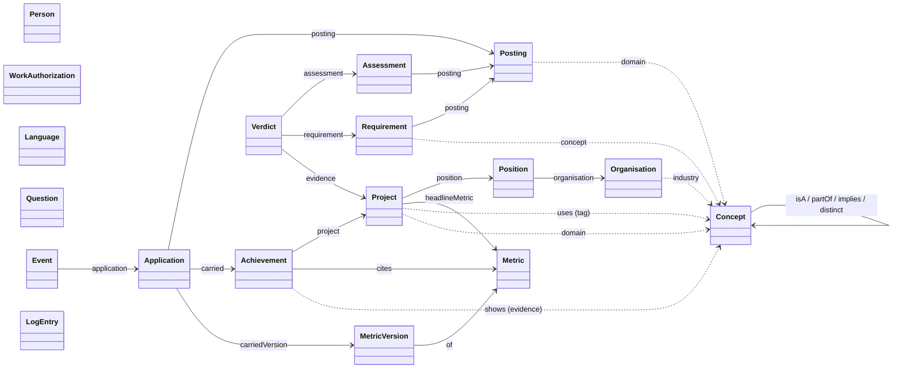

# The ontology

Every class, predicate, enumeration and rule the career record is built from, and what each
one means. Read it to extend the format, write a tool that reads a workspace, or work out why
a finding fired.

**The definition is code.** [`src/jsk/graph/ontology.py`](../src/jsk/graph/ontology.py) holds
the format as data. The entry printer (`jsk kb show`) takes its order from those tables, and the
tier-1 rules are generated from them. This document and the agent-facing
[`references/kb-format.md`](../plugins/jsk/skills/jsk/references/kb-format.md) describe that
file. Where either one disagrees with it, the code is right and the document has a defect. The
class tables in §5 and the enumerations in §6 were generated from `ontology.py` at format
revision 3.

Contents

1. [Design commitments](#1-design-commitments)
2. [Namespaces and identifiers](#2-namespaces-and-identifiers)
3. [Graph kinds](#3-graph-kinds)
4. [The model at a glance](#4-the-model-at-a-glance)
5. [Classes](#5-classes)
6. [Enumerations](#6-enumerations)
7. [Concepts and the vocabulary](#7-concepts-and-the-vocabulary)
8. [Provenance](#8-provenance)
9. [Metrics and versions](#9-metrics-and-versions)
10. [What is derived](#10-what-is-derived)
11. [Matching: requirements, evidence, verdicts](#11-matching-requirements-evidence-verdicts)
12. [Validation rules](#12-validation-rules)
13. [Changesets](#13-changesets)
14. [The log](#14-the-log)
15. [Changing the ontology](#15-changing-the-ontology)

---

## 1. Design commitments

These decisions hold across the whole format. Most of the rules later in this document follow
from one of them.

| Commitment | What it means in practice |
|---|---|
| **One definition** | `ontology.py` is the only place a class or predicate is declared. The printer, the tier-1 validator and the documentation all follow it. It imports only the standard library, so it can be read without pyoxigraph. |
| **Closed per class** | Each class accepts only the predicates listed for it. An unknown predicate is a FAIL (`closed`), and the finding suggests the nearest valid name. `j:note` is the escape hatch for anything the format has no field for. |
| **Type comes from the id** | `k:prj_payments` is a Project because of its `prj_` prefix. Writing `a j:Project` is refused (`no-derived`), and the loader adds `rdf:type` itself. Concepts are the exception: `c:` ids carry no class in their shape, so a concept states `a j:Capability`, `j:Domain` or `j:Technology`. |
| **No blank nodes in the record** | Every node has an id, so every finding can name the thing it is about. The one `[]` allowed is a new bullet inside a changeset, and `jsk kb apply` mints its id. |
| **A graph per record** | Each record - the career, the log, each application's posting, gaps and application - is its own named graph in the store, so a finding can say which graph and which entry it concerns. Queries run over the union of all of them. |
| **Derived data is never written** | Types and the counts-as closure live in the `j:derived` graph, which exists only in memory. The store holds only what a person or `jsk` stated. |
| **Numbers by value** | The store keeps an integer or decimal by value (`8.40` is `8.4`). A number written in any other spelling is refused rather than changed silently - in a changeset, a posting build or a dump `jsk kb load` reads (`changeset.numbers_as_kept`) - while the one-time import of `.ttl` files rewrites each one and lists it; a value whose zeros matter is a string. |
| **Claims carry provenance** | An entry that makes a claim about the person holds `j:provenance`. Changing the claim drops it to `inferred`. Only `jsk kb confirm`, given the person's own answer, raises it back to `confirmed`. |
| **A tag is not evidence** | `Project j:uses` says what a project involved. `Achievement j:shows` says what a bullet proves. Only the second counts as evidence in a verdict. |
| **Numbers are versioned** | A metric's value lives on a `MetricVersion`. A value that an application already sent never changes; a new value becomes the next version. |
| **Retire, don't delete** | Every class accepts `j:retired` plus `j:reason`. A retired entry stays in the record, dated and explained, and drops out of matching and rendering. Deletion is only for entries that were wrong and that nothing points at. |

## 2. Namespaces and identifiers

| Prefix | IRI | Holds |
|---|---|---|
| `j:` | `tag:jsk,2026:ns#` | The ontology itself: classes, predicates, enumeration values (`j:ongoing`, `j:measured`) |
| `k:` | `tag:jsk,2026:id/` | Entry ids: `k:prj_payments`, `k:met_latency.v2` |
| `c:` | `tag:jsk,2026:concept/` | Concepts: `c:kubernetes`, `c:event-driven-architecture` |
| `xsd:` | `http://www.w3.org/2001/XMLSchema#` | Datatypes |
| `op:` | `tag:jsk,2026:op#` | Changeset operations; appears in `.trig` changesets only |

The IRIs use the `tag:` scheme (RFC 4151). They are names, not locations, and nothing
dereferences them. `jsk kb show` and every changeset jsk drafts write the prefix block complete
and in the order `j k c xsd`. Record graphs are named under `tag:jsk,2026:graph/`: `kb`, `log`,
`applications/<dir>/posting`, and so on.

### Entry ids

```
k:<prefix>_<slug>            k:prj_clinical_platform
k:<prefix>_<slug>.v<N>       k:met_latency.v2            (metric versions only)
k:kb   k:person              the two singletons
```

- The slug is lowercase ASCII words joined by `_`: `[a-z0-9]+(_[a-z0-9]+)*`.
- An id is never positional. An Achievement whose id ends `_<digits>` is refused, because it
  says where the bullet sits rather than what it says. `jsk kb apply` mints bullet ids from the
  project and the bullet's content words: `ach_<project>_<two to four words>`.
- An id is never reused. A retired entry keeps its id for good.
- An id is defined in exactly one graph (`duplicate-id`).

### Concept ids

`c:<slug>`, lowercase words joined by `-`: `c:sql-server`, `c:aged-care`.

### Id prefixes

| Prefix | Class | Prefix | Class |
|---|---|---|---|
| `k:kb` | KB | `edu_` | Education |
| `k:person` | Person | `cred_` | Credential |
| `auth_` | WorkAuthorization | `os_` | OpenSource |
| `lang_` | Language | `q_` | Question |
| `org_` | Organisation | `post_` | Posting |
| `pos_` | Position | `req_` | Requirement |
| `prj_` | Project | `app_` | Application |
| `ach_` | Achievement | `evt_` | Event |
| `met_` | Metric | `gap_` | Assessment |
| `met_x.vN` | MetricVersion | `vrd_` | Verdict |
| `skill_` | Skill | `rev_` | LogEntry |

## 3. Graph kinds

The record is a set of named graphs in one store, `career/store/`. A graph's kind follows from its
name, and every class declares which kinds it may appear in (`id-home`).

```
career/store/
  kb                                     kind kb
  log                                    kind log
  applications/<dir>/posting             kind posting
  applications/<dir>/gaps                kind gaps
  applications/<dir>/application         kind application
<package>/jsk/data/vocabulary.ttl        kind vocabulary (shipped, read-only, loaded each run, never stored)
*.trig                                   a changeset or a dump: input, never stored as a file
```

| Kind | Head class (exactly one) | Sections, in order | Written by |
|---|---|---|---|
| `kb` | KB | Identity · Positioning · Work authorization and languages · Vocabulary · Organisations · Roles · Projects · Metrics · Skills · Education · Certifications · Open source · Open questions | `jsk kb apply`, `confirm`, `new`, `load` |
| `log` | none | Log | Every write to the career, in the same update (`apply`, `confirm`, `new`), and the one-time import's one entry (`load`). `jsk freeze`, `jsk event` and the posting and gaps builds add none |
| `posting` | Posting | Posting · Requirements | `jsk posting build`, from the analyst's `decisions.txt` |
| `gaps` | Assessment | Assessment · Verdicts | `jsk tailor prepare` / `jsk match --gaps`, derived from the match plus the analyst's `gaps.txt` |
| `application` | Application | Application · Timeline | `jsk freeze`, `jsk event` |
| `vocabulary` | none | Vocabulary | Shipped with the package |

Sections are how `jsk kb view` groups the career, in this order, and how `jsk kb show` orders
what it prints. A workspace from before the store held each kind as a `.ttl` file
(`career/kb.ttl`, `applications/<dir>/posting.ttl`, ...); `jsk kb load .` imports it once.

## 4. The model at a glance



The diagram leaves out three references that may point at any id: `Question about`,
`LogEntry touched` and `LogEntry minted`. Solid arrows point at `k:` entries, and dotted arrows
at `c:` concepts.

The record falls into three layers:

- **The career** (`kb`): who the person is, where they worked, what they did, and the
  numbers that prove it. It changes over time, and the log records every change.
- **The market** (`posting`, `gaps`): what one advert asks for, and how the career
  measures up against it. These graphs are per application and are rewritten while tailoring.
- **The history** (`application`, `log`): what was sent and what came back, plus every
  change ever made to the record. Once written, these are only appended to.

## 5. Classes

How to read the tables:

- **Card.** is cardinality: `1` required, `0..1` optional, `0..n` any number, `1..n` at least
  one. A missing required predicate, or a second value on a single-valued one, is a FAIL
  (`cardinality`).
- **Object** is the datatype and lexical pattern for a literal, `→ Class` for a reference to a
  `k:` id, `→ concept` for a `c:` concept, or an enumeration from §6. A pattern must match the
  whole lexical form, ASCII digits only. A date must also be a real calendar day:
  `2026-02-30` is refused.
- **Resets** marks the predicates whose change drops a confirmed entry to `inferred` (§8).
  These are the claim predicates, plus the ones that *place* a claim, such as which project a
  bullet sits under.

**Common to every class.** Every class also accepts:

| Predicate | Object | Card. | Meaning |
|---|---|---|---|
| `j:retired` | xsd:date | 0..1 | the day it stopped belonging on a resume |
| `j:reason` | xsd:string | 0..1 | why it was retired; required whenever `retired` is present (`retired-reason`) |
| `j:note` | xsd:string (long) | 0..n | free text: anything the ontology has no field for |
| `j:provenance` | enum `provenance` | 1 | *only on classes marked "provenance yes"* |

Literal kinds used below: a plain string is `xsd:string`. "(long)" marks prose that may span
lines, which `jsk kb show` prints as `"""…"""` and never reflows. Year-month values are strings
matching `YYYY` or `YYYY-MM`.

### 5.1 The career: `kb`

#### KB

The career's header. It records the format revision and the revision the record is at.

id `k:kb` · section (header) · provenance no

| Predicate | Object | Card. | Resets | Meaning |
|---|---|---|---|---|
| `j:format` | xsd:integer, exactly 3 | 1 |  | the format revision |
| `j:name` | xsd:string | 1 |  | whose career this is |
| `j:updated` | xsd:date | 1 |  | the day the last change landed |
| `j:revision` | xsd:integer 1.. | 0..1 |  | the log revision the record is at |

`format`, `updated` and `revision` belong to `jsk`, and a changeset may not set them.

#### Person

The person. A singleton, split across two sections: `positioning` is shown under
Positioning, and everything else under Identity.

id `k:person` · section Identity · provenance yes

| Predicate | Object | Card. | Resets | Meaning |
|---|---|---|---|---|
| `j:fullName` | xsd:string | 1 | yes | the name as it heads a resume |
| `j:givenName` | xsd:string | 0..1 |  | given name |
| `j:familyName` | xsd:string | 0..1 |  | family name |
| `j:headline` | xsd:string | 0..1 | yes | the one-line professional title |
| `j:city` | xsd:string | 0..1 |  | city |
| `j:region` | xsd:string | 0..1 |  | state or region |
| `j:country` | xsd:string `[A-Z]{2}` | 0..1 |  | ISO 3166-1 alpha-2 |
| `j:workMode` | enum `workMode` | 0..1 |  | onsite, hybrid or remote |
| `j:email` | xsd:string | 0..n |  | an email address |
| `j:phone` | xsd:string | 0..n |  | a phone number |
| `j:linkedin` | xsd:string | 0..n |  | a LinkedIn profile |
| `j:github` | xsd:string | 0..n |  | a GitHub profile |
| `j:website` | xsd:string | 0..n |  | a personal site |
| `j:primary` | xsd:string | 0..1 |  | the contact value to lead with; must equal one of the values above (`primary-contact`) |
| `j:positioning` | xsd:string (long) | 0..1 |  | what they are for, in their own words *(written under Positioning)* |

#### WorkAuthorization

A right to work in one jurisdiction.

id `k:auth_<slug>` · section Work authorization and languages · provenance yes

| Predicate | Object | Card. | Resets | Meaning |
|---|---|---|---|---|
| `j:jurisdiction` | xsd:string | 1 |  | where it applies: a country code, or EU and so on |
| `j:kind` | enum `authKind` | 1 | yes | the basis |
| `j:authorization` | enum `authorization` | 1 | yes | its status |
| `j:validUntil` | xsd:date | 0..1 |  | when it lapses |

#### Language

A spoken language.

id `k:lang_<slug>` · section Work authorization and languages · provenance yes

| Predicate | Object | Card. | Resets | Meaning |
|---|---|---|---|---|
| `j:language` | xsd:string `[a-z]{2,3}(-[A-Za-z0-9]{2,8})*` | 1 |  | a BCP 47 tag |
| `j:native` | xsd:boolean | 0..1 |  | a first language |
| `j:scheme` | enum `languageScheme` | 0..1 |  | the scale `level` is on |
| `j:level` | xsd:string | 0..1 | yes | the level on that scale |

#### Concept

A matching term: a capability, a domain or a technology. Concepts are covered in full in §7.
They appear both in the shipped `vocabulary.ttl` and in the career's own Vocabulary section.

id `c:<slug>` · graphs kb, vocabulary · section Vocabulary · provenance no ·
class stated as `a j:Capability | j:Domain | j:Technology`

| Predicate | Object | Card. | Resets | Meaning |
|---|---|---|---|---|
| `j:label` | xsd:string | 0..n |  | a name it goes by; matched after normalising |
| `j:former` | xsd:string | 0..n |  | a name it used to go by |
| `j:isA` | → concept | 0..n |  | counts as this broader concept |
| `j:partOf` | → concept | 0..n |  | counts as the whole it is part of |
| `j:implies` | → concept | 0..n |  | suggests this; never satisfies a required one |
| `j:distinct` | → concept | 0..n |  | never the same thing, whatever the names say |
| `j:unlabel` | xsd:string | 0..n |  | a shipped label or former label this person drops *(kb only)* |
| `j:unlink` | → concept | 0..n |  | a shipped isA or partOf edge to that concept this person drops *(kb only)* |

#### Organisation

An employer or a client.

id `k:org_<slug>` · section Organisations · provenance yes

| Predicate | Object | Card. | Resets | Meaning |
|---|---|---|---|---|
| `j:name` | xsd:string | 1 | yes | the organisation's name |
| `j:relationship` | enum `relationship` | 1 |  | employer, prospect or both |
| `j:industry` | → concept (Domain) | 0..n |  | its industries |
| `j:size` | xsd:string | 0..1 |  | headcount band, e.g. 1001-5000 |

#### Position

A job title held at an organisation. A promotion gets a new Position, not an edited title.

id `k:pos_<slug>` · section Roles · provenance yes

| Predicate | Object | Card. | Resets | Meaning |
|---|---|---|---|---|
| `j:organisation` | → Organisation | 1 | yes | where |
| `j:title` | xsd:string | 1 | yes | the title as the employer wrote it |
| `j:functionalTitle` | xsd:string | 0..1 |  | renders in parentheses; never replaces title |
| `j:start` | year-month | 1 | yes | YYYY-MM or YYYY |
| `j:end` | year-month | 0..1 | yes | omitted while ongoing |
| `j:state` | enum `state` | 1 |  | ended, ongoing or unknown |
| `j:seniority` | enum `seniority` | 1 | yes | one of the closed eight |
| `j:change` | enum `change` | 0..1 |  | how they came into it |
| `j:engagementKind` | enum `engagementKind` | 0..1 |  | employment unless stated |

The dates have to agree with the state (`period`). An `ongoing` role has no `end`. An `ended`
role must have one. `end` cannot come before `start`. When one date is a bare year and the
other a year-month, only the years are compared, so `2016` does not count as ending before
`2016-08`.

#### Project

An engagement or a product, and the unit of evidence. Bullets hang off a project, and matching
ranks projects.

id `k:prj_<slug>` · section Projects · provenance yes

| Predicate | Object | Card. | Resets | Meaning |
|---|---|---|---|---|
| `j:name` | xsd:string | 1 | yes | the project's name |
| `j:position` | → Position | 0..1 | yes | the role it was done in |
| `j:strength` | xsd:integer 1..5 | 1 |  | evidence quality, 5 flagship |
| `j:recency` | xsd:integer 1950..2100 | 1 |  | the last year worked on |
| `j:seniority` | enum `seniority` | 0..1 | yes | the level it shows |
| `j:domain` | → concept (Domain) | 0..n |  | the domains it was in |
| `j:uses` | → concept | 0..n |  | tags: what it involved; **not evidence** |
| `j:headlineMetric` | → Metric | 0..1 |  | the number it leads with |
| `j:noneQuantified` | xsd:boolean | 0..1 |  | true when no number exists |
| `j:problem` | xsd:string (long) | 0..1 |  | the problem, in prose |
| `j:decision` | xsd:string (long) | 0..1 |  | what they decided, in prose |
| `j:outcome` | xsd:string (long) | 0..1 |  | what changed, in prose |

`headlineMetric` and `noneQuantified true` exclude each other (`headline-xor`). A headline
metric that none of the project's bullets cites is a WARN (`headline-cited`). A project whose
bullets cannot be placed under a role fails the record gate when rendered.

#### Achievement

A bullet: one sentence, written once and reused on every resume that carries it. It sits under
its project in the Projects section.

id `k:ach_<slug>` (never positional) · section Projects · provenance yes

| Predicate | Object | Card. | Resets | Meaning |
|---|---|---|---|---|
| `j:project` | → Project | 1 | yes | the project it belongs to |
| `j:rank` | xsd:integer 1.. | 1 |  | its order under the project; unique among the project's live bullets (`rank-unique`) |
| `j:text` | xsd:string (long) | 1 | yes | the bullet, written once and reused |
| `j:cites` | → Metric | 0..n | yes | the metrics whose numbers it states |
| `j:shows` | → concept | 0..n | yes | what it is evidence of |

Every number in `text` must match a current version of a metric the bullet `cites`. The record
gate checks this at render time, and `jsk match` asks about any bullet that fails it.

#### Metric

A measured quantity. The metric itself holds no number: its values live on its versions (§9).

id `k:met_<slug>` · section Metrics · provenance no

| Predicate | Object | Card. | Resets | Meaning |
|---|---|---|---|---|
| `j:subject` | xsd:string | 1 |  | what is measured |
| `j:unit` | xsd:string | 0..1 |  | its unit |
| `j:direction` | enum `direction` | 0..1 |  | which way is better |

#### MetricVersion

One value of a metric over a period. It is written directly after its metric.

id `k:met_<slug>.v<N>` · section Metrics · provenance yes

| Predicate | Object | Card. | Resets | Meaning |
|---|---|---|---|---|
| `j:of` | → Metric | 1 | yes | the metric it is a version of; must match the id (`version-orphan`) |
| `j:baseline` | xsd:integer or xsd:decimal | 0..1 | yes | the value before |
| `j:value` | xsd:integer or xsd:decimal | 1 | yes | the value; the bottom of a range |
| `j:upper` | xsd:integer or xsd:decimal | 0..1 | yes | the top of a range; greater than `value` (`range-upper`) |
| `j:qualifier` | enum `qualifier` | 0..1 | yes | at-least (15+), about (~12), under (<1) or over (>5); on a range, it qualifies the top |
| `j:kind` | enum `metricKind` | 0..1 | yes | absolute, delta, ratio and so on |
| `j:confidence` | enum `confidence` | 1 |  | measured, estimated or reported |
| `j:source` | xsd:string | 0..1 |  | where the number comes from |
| `j:validFrom` | xsd:date | 0..1 |  | when it became true |
| `j:validUntil` | xsd:date | 0..1 |  | when a later version replaced it |

#### Skill

A skill as it is displayed on a resume. Skills are presentation only: matching never reads
them, so a skill listed here counts for nothing on its own.

id `k:skill_<slug>` · section Skills · provenance no

| Predicate | Object | Card. | Resets | Meaning |
|---|---|---|---|---|
| `j:name` | xsd:string | 1 |  | the display name |
| `j:category` | xsd:string | 1 |  | the group it is shown under |
| `j:rank` | xsd:integer 1.. | 0..1 |  | display order in its category |
| `j:alias` | xsd:string | 0..n |  | other names an ATS may look for |

#### Education

A qualification.

id `k:edu_<slug>` · section Education · provenance yes

| Predicate | Object | Card. | Resets | Meaning |
|---|---|---|---|---|
| `j:institution` | xsd:string | 1 | yes | where |
| `j:qualification` | xsd:string | 1 | yes | the award |
| `j:field` | xsd:string | 0..1 | yes | the field of study |
| `j:level` | enum `educationLevel` | 0..1 | yes | ISCED level |
| `j:start` | year-month | 0..1 | yes | YYYY-MM or YYYY |
| `j:end` | year-month | 0..1 | yes | YYYY-MM or YYYY |
| `j:gradeScheme` | xsd:string | 0..1 | yes | the grading scheme |
| `j:gradeValue` | xsd:integer, xsd:decimal or xsd:string | 0..1 | yes | the grade |

#### Credential

A certification the person actually earned.

id `k:cred_<slug>` · section Certifications · provenance yes

| Predicate | Object | Card. | Resets | Meaning |
|---|---|---|---|---|
| `j:name` | xsd:string | 1 | yes | the credential |
| `j:issuer` | xsd:string | 1 | yes | who issued it |
| `j:issued` | year-month | 0..1 | yes | YYYY-MM or YYYY |
| `j:expires` | year-month | 0..1 | yes | YYYY-MM or YYYY |
| `j:credentialState` | enum `credentialState` | 1 |  | active, expired or lapsed |
| `j:url` | xsd:string `\S+` | 0..1 |  | where it can be verified |

#### OpenSource

Public code the person worked on.

id `k:os_<slug>` · section Open source · provenance yes

| Predicate | Object | Card. | Resets | Meaning |
|---|---|---|---|---|
| `j:name` | xsd:string | 1 |  | the project |
| `j:url` | xsd:string `\S+` | 1 |  | where the code is |
| `j:role` | enum `openSourceRole` | 1 | yes | their part in it |

#### Question

The gap queue: something to ask the person, about one or more entries.

id `k:q_<slug>` · section Open questions · provenance no

| Predicate | Object | Card. | Resets | Meaning |
|---|---|---|---|---|
| `j:about` | → any id | 1..n |  | the entries it is about; `k:kb` for the career as a whole |
| `j:question` | xsd:string | 1 |  | the question, ready to ask aloud |
| `j:asked` | xsd:date | 1 |  | when it was raised |
| `j:answered` | xsd:date | 0..1 |  | when it was answered; not before `asked` (`answered-before-asked`) |

A question stays open until it has `answered`. Any entry left `inferred` or
`needs-verification` should have an open question about it (`inferred-unasked`), and `jsk kb
apply` opens one automatically when it lowers an entry's provenance.

### 5.2 The market: `posting` and `gaps`

#### Posting

A job advertisement. The advert's own text sits next to it, verbatim, in `posting.md`.

id `k:post_<slug>` · graph posting · section Posting · provenance no

| Predicate | Object | Card. | Resets | Meaning |
|---|---|---|---|---|
| `j:company` | xsd:string | 1 |  | the employer advertising |
| `j:title` | xsd:string | 1 |  | the advertised title |
| `j:url` | xsd:string `\S+` | 0..1 |  | where it was advertised |
| `j:seniority` | enum `seniority` | 0..1 |  | the level it asks for |
| `j:domain` | → concept (Domain) | 0..n |  | its domains |
| `j:captured` | xsd:date | 1 |  | the day it was saved |
| `j:advert` | xsd:string, exactly `posting.md` | 1 |  | the verbatim advert beside it |

#### Requirement

One thing a posting asks for.

id `k:req_<slug>` · graph posting · section Requirements · provenance no

| Predicate | Object | Card. | Resets | Meaning |
|---|---|---|---|---|
| `j:posting` | → Posting | 1 |  | the posting asking |
| `j:asked` | xsd:string | 1 |  | the term as the advert wrote it |
| `j:necessity` | enum `necessity` | 1 |  | required, preferred or implicit |
| `j:concept` | → concept | 0..n |  | the concepts meant, any one of which satisfies it: one when the label is ambiguous, several when the advert lists alternatives |
| `j:quote` | xsd:string (long) | 1 |  | the advert's own words |

`quote` must appear in `posting.md` word for word (`quote-verbatim`). The comparison ignores
typography, whitespace and Markdown emphasis. A requirement is resolved to concepts through
`asked` unless `concept` is given (§11). Leave `concept` out when `asked` resolves on its own.
State it when the term is ambiguous, unknown, or lists alternatives ("AWS/GCP/Azure").

#### Assessment

A posting's gap assessment, written by code. `jsk` derives it from the match and folds in the
analyst's `gaps.txt`, which may only lower a verdict and must give a reason.

id `k:gap_<stem>` · graph gaps · section Assessment · provenance no

| Predicate | Object | Card. | Resets | Meaning |
|---|---|---|---|---|
| `j:posting` | → Posting | 1 |  | the posting assessed |
| `j:assessed` | xsd:date | 1 |  | the day it was derived |
| `j:fit` | enum `fit` | 1 |  | strong, partial or poor |
| `j:eligibility` | xsd:string | 0..1 |  | the analyst's eligibility judgement |
| `j:fallsShort` | xsd:string (long) | 0..1 |  | where it falls short, most load-bearing first; one item a line |
| `j:surplus` | xsd:string (long) | 0..1 |  | surplus worth knowing about; one item a line |
| `j:questions` | xsd:string (long) | 0..1 |  | the questions to ask, in order; one a line |

The default `fit` is `poor` when any required requirement is `unsatisfied`, `strong` when every
required requirement is `satisfied`, and `partial` otherwise.

#### Verdict

One requirement's verdict.

id `k:vrd_<stem>_<slug>` · graph gaps · section Verdicts · provenance no

| Predicate | Object | Card. | Resets | Meaning |
|---|---|---|---|---|
| `j:assessment` | → Assessment | 1 |  | the assessment |
| `j:requirement` | → Requirement | 1 |  | the requirement judged |
| `j:matched` | enum `verdict` | 0..1 |  | the match's verdict; absent when implicit |
| `j:verdict` | enum `verdict` | 1 |  | the verdict that stands |
| `j:flag` | enum `flag` | 0..n |  | a review the derived verdict asks of the analyst |
| `j:evidence` | → Project | 0..n |  | the projects behind the verdict |
| `j:basis` | xsd:string | 1 |  | why the match says what it says |
| `j:shortfall` | xsd:string | 0..1 |  | the analyst's reason for lowering it |

`matched` is what the record supports, and `verdict` is what stands after the analyst's review.
When the two differ, `shortfall` says why. The one flag, `listed-names`, fires on a satisfied
requirement whose quote names specific things (for example "Pinecone, Milvus") that none of
the confirmed evidence bullets mentions.

### 5.3 The history: `application` and `log`

#### Application

A submission. `jsk freeze` writes it, and after that it is never edited.

id `k:app_<slug>` · graph application · section Application · provenance no

| Predicate | Object | Card. | Resets | Meaning |
|---|---|---|---|---|
| `j:posting` | → Posting | 1 |  | what it answered; must be the posting of the same application (`application-posting`) |
| `j:view` | xsd:string | 0..1 |  | `"resume"` for a short resume.json; a legacy record's URS view |
| `j:submitted` | xsd:date, or xsd:boolean `false` | 1 |  | the day it was sent, or false when held back |
| `j:channel` | xsd:string | 0..1 |  | how it was sent |
| `j:document` | xsd:string | 0..n |  | a file that was sent |
| `j:recordSha256` | xsd:string `[0-9a-f]{64}` | 0..1 |  | the frozen resume.json's hash |
| `j:carried` | → Achievement | 0..n |  | bullets it sent |
| `j:carriedVersion` | → MetricVersion | 0..n |  | metric versions it sent |

`carried` and `carriedVersion` are what let the record answer "what did I tell them?" after the
career has moved on. They are also why a sent metric version is never edited (§9).

#### Event

Something that happened to an application. `jsk event` appends these.

id `k:evt_<slug>` · graph application · section Timeline · provenance no

| Predicate | Object | Card. | Resets | Meaning |
|---|---|---|---|---|
| `j:application` | → Application | 1 |  | the application |
| `j:date` | xsd:date, or xsd:string `unknown` | 1 |  | the day it happened, or unknown; a WARN if before `submitted` (`event-before-submit`) |
| `j:kind` | enum `eventKind` | 1 |  | the pipeline vocabulary |
| `j:channel` | xsd:string | 0..1 |  | how |
| `j:due` | xsd:date | 0..1 |  | a date somebody committed to |

#### LogEntry

One change to the career (§14).

id `k:rev_<N>` · graph log · section Log · provenance no

| Predicate | Object | Card. | Resets | Meaning |
|---|---|---|---|---|
| `j:revision` | xsd:integer 1.. | 1 |  | counts up from 1 |
| `j:date` | xsd:date | 1 |  | the day |
| `j:by` | enum `logBy` | 1 |  | the command that wrote it |
| `j:summary` | xsd:string (long) | 1 |  | what changed |
| `j:touched` | → any id (may dangle) | 0..n |  | ids changed |
| `j:minted` | → any id (may dangle) | 0..n |  | ids created |
| `j:answer` | xsd:string (long) | 0..1 |  | the person's answer, for a confirm |
| `j:kbSha256` | sha256 hex | 1 |  | the career's hash after the change, as the writer lays it out |

`touched` and `minted` may point at ids that no longer exist, because the log outlives what it
records. They are the only references exempt from `dangling`. `j:kbSha256` is the hash of the
career as the writer lays it out as Turtle - the text a write's diff shows - and every entry
carries one. It guards the way in: `jsk kb load` refuses a dump whose career is not what its
newest entry hashed, so an edited provenance or number is not loaded unlogged, and `jsk kb
check` FAILs a store whose career does not match it - one written outside jsk. A plain load does
not check it: that would cost a full write of the career on every command.

## 6. Enumerations

An enumeration value is written as a `j:` individual (`j:ongoing`), never as a string. Values
are listed in declaration order. For `seniority` that order is also the ranking, most senior
first.

| Enum | Used by | Values, in order |
|---|---|---|
| `provenance` | every claim-bearing class | `confirmed` · `inferred` · `needs-verification` · `disputed` |
| `workMode` | Person | `onsite` · `hybrid` · `remote` |
| `authKind` | WorkAuthorization.kind | `citizen` · `permanent` · `employment-visa` · `residence` · `student` · `working-holiday` · `none` |
| `authorization` | WorkAuthorization | `held` · `expired` · `eligible` · `requires-sponsorship` |
| `languageScheme` | Language.scheme | `cefr` · `ilr` · `jlpt` · `ielts` · `reported` |
| `conceptClass` | a concept's `a` | `Capability` · `Domain` · `Technology` |
| `relationship` | Organisation | `employer` · `prospect` · `both` |
| `state` | Position | `ended` · `ongoing` · `unknown` |
| `seniority` | Position, Project, Posting | `architecture-ownership` · `product-ownership` · `platform-design` · `team-leadership` · `technical-ownership` · `hands-on-senior` · `hands-on` · `junior` |
| `change` | Position | `hire` · `promotion` · `lateral` · `title-change` |
| `engagementKind` | Position | `employment` · `contract` · `freelance` · `internship` · `volunteer` · `break` |
| `direction` | Metric | `increase` · `decrease` |
| `metricKind` | MetricVersion.kind | `absolute` · `delta` · `ratio` · `duration` · `rank` · `count` |
| `confidence` | MetricVersion | `measured` · `estimated` · `reported` |
| `qualifier` | MetricVersion | `at-least` · `about` · `under` · `over` |
| `educationLevel` | Education.level | `isced-5` · `isced-6` · `isced-7` · `isced-8` |
| `credentialState` | Credential | `active` · `expired` · `lapsed` |
| `openSourceRole` | OpenSource.role | `maintainer` · `contributor` · `author` |
| `necessity` | Requirement | `required` · `preferred` · `implicit` |
| `verdict` | Verdict.matched, Verdict.verdict | `satisfied` · `partial` · `unevidenced` · `unsatisfied` · `indeterminate` |
| `fit` | Assessment | `strong` · `partial` · `poor` |
| `flag` | Verdict | `listed-names` |
| `eventKind` | Event.kind | `submitted` · `acknowledged` · `screen-scheduled` · `screen-done` · `interview-scheduled` · `interview-done` · `onsite-scheduled` · `onsite-done` · `offer` · `offer-accepted` · `rejected` · `withdrawn` · `no-response` · `offer-declined` · `follow-up-sent` · `note` · `referral` · `recruiter-contact` |
| `logBy` | LogEntry.by | `apply` · `confirm` · `new` · `load` - and on entries from before the store, `adopt` · `migrate` · `fmt`, commands that no longer exist |

Notes on a few values:

- **`seniority`** is closed at eight values. A project at or above the posting's level earns
  the seniority point when projects are ranked (§11).
- **`verdict`**: the first four are ranked, from `satisfied` down to `unsatisfied`.
  `indeterminate` is left out of the ranking because it describes the record, not the
  candidate: the record cannot yet say what the term means.
- **`qualifier`** keeps how a number was stated: "50+ tenants" is not the same claim as "50
  tenants". `jsk` renders `at-least` as `15+`, `about` as `~12`, `under` as `<1` and `over` as
  `>5`. On a range, the qualifier applies to the top: `300-800+`.
- **`logBy` `new`** marks the first revision written by `jsk new`, or by a `--force` start-over.
  A changeset whose `op:base` is older than the newest `new` entry is refused: it was drafted
  against the career that was started over.
- **`logBy` `load`** marks the one entry the one-time import (`jsk kb load` of a workspace laid
  out as files) adds: the career stamped at the next revision, and the entry holding its hash.
- **`logBy` `migrate`** marks a first revision written by the retired `jsk migrate`. Nothing
  writes it now; it stays valid so a log written before still loads.

## 7. Concepts and the vocabulary

Concepts are the terms that postings and the career are matched on.

### 7.1 Concept classes

| Class | What it is | Examples |
|---|---|---|
| `j:Technology` | A named product, language, platform or tool | `c:kubernetes`, `c:csharp`, `c:azure-sql` |
| `j:Capability` | Something a person can do, independent of tools | `c:api-design`, `c:mentoring`, `c:event-driven-architecture` |
| `j:Domain` | An industry or field of application | `c:healthcare`, `c:aged-care` |

`Organisation.industry`, `Project.domain` and `Posting.domain` accept only Domains
(`concept-class`). Every other concept reference accepts any class.

### 7.2 Where concepts come from

| Source | Holds | Who owns it |
|---|---|---|
| `src/jsk/data/vocabulary.ttl` (shipped) | **Technologies only**, with their labels, former names, and `isA`/`partOf`/`distinct` edges among themselves | The package; updated by releases |
| the career's Vocabulary | The person's capabilities and domains, their own technologies, extra labels and edges on shipped concepts, and any narrowing | The person |
| `src/jsk/data/capabilities.ttl` (pack) | About 110 capabilities and domains, with posting wordings and edges that hold for anyone | Nobody until applied. It is never loaded. `jsk kb pack capabilities` drafts it as a changeset. |

The shipped vocabulary is restricted to technologies (`shipped-vocabulary`) for a reason. A
technology alias is close to a fact: K8s is Kubernetes. A capability edge is a judgement, and
a judgement shipped to every user is how a graph starts to overclaim. So capability edges,
domains and `implies` exist only in a person's own career. The starter pack is a proposal
that the person reads and applies, and once applied it is theirs.

A shipped concept keeps its shipped class. A career that reclassifies one is a FAIL
(`concept-reclassed`); the fix is to add a capability of your own and relate the two.

### 7.3 Names

- **`label`**: a name the concept goes by. Labels are matched after normalising: lowercased,
  with runs of whitespace turned into `-`.
- **`former`**: a name it used to go by (`Azure AD` for `c:entra-id`). It matches exactly like
  a label.
- Two concepts sharing a label is a WARN (`label-clash`). The clash is allowed, because some
  words really are ambiguous, and the match will ask which concept a posting means rather than
  guess.

### 7.4 Edges

The three *counts-as* edges run one way, from narrower to broader:

| Edge | Reads | Example |
|---|---|---|
| `isA` | A is a kind of B | `c:aks isA c:kubernetes` |
| `partOf` | A is a part of B | `c:aks partOf c:azure` |
| `implies` | A suggests B | `c:kafka implies c:event-driven-architecture` |
| `distinct` | A is never B, whatever the names say | `c:java distinct c:javascript` |

- Holding AKS counts toward a requirement for Kubernetes. Holding Kubernetes does **not** count
  toward AKS. Direction is what separates evidence from a guess.
- A path through `implies` never satisfies a *required* requirement. It can only produce
  `near`, which becomes a question for the person.
- A cycle through counts-as edges is a FAIL (`counts-as-cycle`). So is a `distinct` pair where
  one concept counts as the other through any path (`wall-crossed`).
- A capability defined in the career with no label and no `isA`/`partOf` matches only its exact
  id. That is one WARN for all such capabilities together (`concepts-bare`), and `jsk kb query
  bare` lists them.

### 7.5 Narrowing the shipped vocabulary

The shipped file is not the person's to edit, and a local copy would stop picking up releases.
So the career narrows it with statements instead:

```turtle
c:golang j:unlabel "Go" .          # in this person's field, "Go" is never the language
c:openshift j:unlink c:kubernetes . # drop the shipped isA/partOf edge to c:kubernetes
```

The loader applies these to the shipped graph in memory before anything else runs. A narrowing
statement that removes nothing, usually a typo, is a FAIL (`narrows-nothing`) rather than a
silent no-op. `unlabel`, `unlink` and `implies` are refused inside `vocabulary.ttl` itself.

## 8. Provenance

Every class marked "provenance yes" in §5 carries exactly one `j:provenance`:

| Value | Means |
|---|---|
| `confirmed` | The person said it, and their words are in the log |
| `inferred` | Drafted for them, and not yet signed off |
| `needs-verification` | A known gap: probably true, but unchecked |
| `disputed` | The person or a source contradicts it. A disputed bullet is evidence of nothing. |

The classes without provenance are Concept, Metric, Skill, Question, and everything outside
the `kb` graph. A concept or a metric subject is vocabulary, not a claim. A skill is display text
that matching never reads. A question is a request, not an assertion.

**What resets it.** Three things happen when a changeset changes a predicate
marked **Resets** on a confirmed entry:

1. the entry drops to `inferred`;
2. a `q_` question opens about it;
3. the entry shows up in `jsk kb query unconfirmed` until someone answers the question.

The reset predicates are the claim predicates, plus the ones that *place* a claim (`PLACES` in
`ontology.py`): `organisation`, `position`, `project`, `of`, `cites`, `start`, `end`, `field`,
`level`, `gradeScheme`, `gradeValue` and `expires`. Moving "led a team of 6" to a different
role changes what the person confirmed, even though the words stayed the same.

**What raises it.** Only `jsk kb confirm <id> --answer "…"`. The answer is recorded on the log
entry and is the audit trail. An answer that agrees without saying what was agreed to ("yes",
"ok", "done", "n/a") or that contradicts the claim ("no", "wrong") is a WARN
(`answer-placeholder`). A changeset may never write `j:confirmed`.

**What reads it.** The resume selection draws only from entries at or above the provenance
floor set in `resume.json`. A verdict can reach `satisfied` only through a *confirmed* bullet
(§11).

## 9. Metrics and versions

```turtle
k:met_latency j:subject "p95 clinical event latency" ; j:direction j:decrease .
k:met_latency.v1 j:of k:met_latency ; j:baseline 5 ; j:value 1 ;
    j:confidence j:measured ; j:validUntil "2026-03-01"^^xsd:date ; j:provenance j:confirmed .
k:met_latency.v2 j:of k:met_latency ; j:baseline 5 ; j:value 0.8 ;
    j:confidence j:measured ; j:validFrom "2026-03-01"^^xsd:date ; j:provenance j:inferred .
```

- A version's id is its metric's id plus `.vN` (`version-orphan`). Versions are numbered from
  v1 with no gaps (`version-gap`, WARN).
- Exactly one version is current, meaning it has no `validUntil` (`metric-open`).
- **A sent version is frozen.** When a changeset sets `value`, `baseline`, `upper`,
  `qualifier` or `kind` on a version an application `carriedVersion`, `jsk kb apply` writes the
  new value to the next version and closes the old one. The new version inherits everything
  except `validFrom`, `validUntil`, `provenance`, `note`, `retired` and `reason`.
- `jsk kb query stale` lists every application that sent a version which has since been
  replaced.
- Ranges and loose numbers: "15-20" is `j:value 15 ; j:upper 20`; "50+" is `j:value 50 ;
  j:qualifier j:at-least`. Two numbers in one sentence are two metrics.

## 10. What is derived

The loader builds a working graph that exists only in memory. In order:

1. **Parse** each file into its own named graph (`file:<relative path>`), and run the tier-1
   rules on it.
2. **Narrow** the shipped vocabulary with the person's `unlabel`/`unlink` statements (§7.5).
3. **Derive types.** Every `k:` id gets `rdf:type j:<Class>` from its prefix, written into
   `j:derived`.
4. **Run the tier-2 rules** over the union graph (§12).
5. **Materialise paths.** The counts-as closure is written into `j:derived` as `j:Path` nodes:

```turtle
<…derived/path/<md5>> a j:Path ;
    j:from c:aks ; j:to c:kubernetes ; j:via c:aks ; j:hops 1 ; j:implied false .
```

| Hops | Meaning |
|---|---|
| 0 | Every concept counts as itself |
| 1 | One `isA`, `partOf` or `implies` edge |
| 2 | Two edges through a `via` concept. Nothing further: a three-hop chain is treated as too weak to count as evidence. |

`implied` is true when any edge on the path is `implies`. Paths run from narrower to broader
only. A path's id is a hash of its ends, its via and its hop count, so the same path found
twice is stored once.

Nothing in `j:derived` is ever written to disk, and rules that inspect stated data filter it
out explicitly (`FILTER(?g != j:derived)`).

## 11. Matching: requirements, evidence, verdicts

`jsk match` joins one posting's requirements to the career through the vocabulary. The steps
below are its semantics. Code: [`queries.py`](../src/jsk/graph/queries.py),
[`match.py`](../src/jsk/graph/match.py), [`gapsderive.py`](../src/jsk/graph/gapsderive.py).

**1. Resolve the requirement to concepts.**

1. If the requirement has `j:concept`, use it. Any concept listed satisfies the requirement.
2. Otherwise normalise `asked` and look it up as a concept id and among all labels and former
   labels. An id counts only when no *other* concept goes by the same word. For example, a
   personal `c:go` does not silently claim an advert's "Go".
3. Exactly one hit: `resolved`. Several: `ambiguous`. None: `candidate`, an unknown term.

**2. Find carriers.** A live project *carries* a resolved requirement when it `uses` a concept
with a path to one of the requirement's concepts. The shortest path wins.

**3. Assign a bucket.**

| Bucket | When |
|---|---|
| `matched` | Some project carries it |
| `near` | Only through an `implies` path while the requirement is `required`, or a project holds only something *broader* (Kubernetes held, EKS asked) |
| `missing` | Resolved, but nothing carries it |
| `ambiguous` / `candidate` | Could not be resolved (step 1) |
| `implicit` | `necessity implicit`: not assessed |

**4. Grade the evidence** for each carrier.

| Level | When |
|---|---|
| `confirmed` | A live, confirmed bullet under the project `shows` a concept with a non-implied path to the requirement's concept |
| `unconfirmed` | Only inferred or needs-verification bullets do |
| `tag` | Only the project's `uses` does, which is a claim and not evidence |

**5. Default verdict** (`j:matched`):

| Bucket | Verdict |
|---|---|
| `matched` with confirmed evidence | `satisfied` |
| `matched` without | `unevidenced` |
| `near` | `partial` |
| `missing` | `unsatisfied` |
| `ambiguous`, `candidate` | `indeterminate` |
| `implicit` | none |

The analyst's `gaps.txt` may **lower** a verdict and must give a `shortfall` when it does. It
can never raise one. The standing verdict goes in `j:verdict`.

**6. Rank projects.** Each live project scores: 3 per required requirement it carries, plus 1
per preferred one, plus 2 × `strength`, plus recency (1 if within three years, 0.5 at four to
six years, 0 after that), plus 1 when its `seniority` is at or above the posting's. Ties
break on strength, then recency, then id.

**7. Choose the cover.** The cover is the smallest set of projects, at most three by default
(`--cover N`), that between them carry every required requirement any project can carry. Among
sets of the same size, the one whose projects rank highest wins. The cover is what `jsk kb
export --from-match` builds the draft resume from.

## 12. Validation rules

Every command that reads the record loads and validates the whole workspace first. Each
finding carries a rule id, a severity, the graph (`kb`, `applications/<dir>/posting`), the id it
concerns, and a fix; the store has no lines to number. A FAIL stops anything that would write or
render. A WARN is reported and the command goes on.

### 12.1 Tier 1: one graph, generated from the ontology

Code: [`shapes.py`](../src/jsk/graph/shapes.py).

| Rule | Severity | Fires when |
|---|---|---|
| `syntax` | FAIL | Text input - a changeset, a dump, a file `jsk kb load` imports - does not parse. `dangling` is suppressed until it does. |
| `id-form` | FAIL | A subject is not a jsk id; a concept slug is malformed; a bullet id is positional |
| `id-home` | FAIL | A class appears in a graph kind it does not belong to |
| `closed` | FAIL | A predicate is not declared for the subject's class (the nearest name is suggested) |
| `cardinality` | FAIL | A required predicate is missing, a single-valued one holds several values, or the graph's head class is not present exactly once |
| `object` | FAIL | Wrong datatype, pattern, range, enum value, reference target class, or an impossible date |
| `no-blank-nodes` | FAIL | `[ ]` or `_:` in the record |
| `no-derived` | FAIL | `rdf:type` stated on a `k:` id |
| `retired-reason` | FAIL | `retired` without `reason` |
| `shipped-vocabulary` | FAIL | `vocabulary.ttl` holds a non-Technology, or uses `implies`, `unlabel` or `unlink` |

### 12.2 Tier 2: the whole workspace, as SPARQL

Code: [`rules.py`](../src/jsk/graph/rules.py). Each rule is one row: an id, a severity, a
SELECT naming `?focus`, and an optional post-processing step.

| Rule | Severity | Fires when |
|---|---|---|
| `dangling` | FAIL | A reference to a `k:` or `c:` id nothing defines (except log `touched`/`minted`) |
| `duplicate-id` | FAIL | An id is defined in more than one graph |
| `concept-typed` | FAIL | A concept with no class |
| `concept-class` | FAIL | `industry` or `domain` points at a non-Domain |
| `concept-reclassed` | FAIL | The career gives a shipped concept a different class |
| `primary-contact` | FAIL | `primary` is not one of the person's contact values |
| `headline-xor` | FAIL | `headlineMetric` together with `noneQuantified true` |
| `headline-cited` | WARN | A headline metric that no bullet of the project cites |
| `metric-open` | FAIL | A metric without exactly one current version |
| `range-upper` | FAIL | `upper` ≤ `value` |
| `version-orphan` | FAIL | A version's `of` disagrees with its id |
| `version-gap` | WARN | Versions not numbered v1, v2, … without gaps |
| `period` | FAIL | A role's dates contradict its state or each other |
| `rank-unique` | FAIL | Two live bullets of a project share a rank |
| `counts-as-cycle` | FAIL | A concept counts as itself through isA/partOf/implies |
| `wall-crossed` | FAIL | Two concepts declared `distinct`, where one still counts as the other |
| `label-clash` | WARN | Two concepts share a normalised label |
| `narrows-nothing` | FAIL | An `unlabel`/`unlink` that removes nothing shipped |
| `concepts-bare` | WARN | The career's capabilities with neither labels nor edges (one finding covers them all) |
| `inferred-unasked` | WARN | An inferred or needs-verification entry with no open question about it |
| `retired-referenced` | WARN | A live entry points at a retired one (history references are exempt) |
| `answered-before-asked` | FAIL | A question answered before it was asked |
| `quote-verbatim` | FAIL | A requirement's quote is empty, missing from `posting.md`, or `posting.md` is absent |
| `necessity-wording` | WARN | A quote says "must" but is marked preferred, or says "nice to have" but is marked required |
| `advert-uncovered` | WARN | A requirement-like line in the advert that no requirement quotes and `decisions.txt` has not dropped. Eligibility lines are exempt, since they belong in `gaps.md`. |
| `application-posting` | FAIL | An application points at another application's posting |
| `event-before-submit` | WARN | An event dated before its application was submitted |
| `answer-placeholder` | WARN | A confirm whose answer is empty, a placeholder, or a denial |

Every rule id has a mutation test that proves it fires ([`tests/test_graph_shapes.py`](../tests/test_graph_shapes.py),
[`tests/test_graph_rules.py`](../tests/test_graph_rules.py)). A rule without one fails the
suite. Three rules now fire only on the `.ttl` files the one-time import reads (`jsk kb
load`): `comment` (a comment the store would not keep), `log-sync` (the career file and its log
disagreeing) and `hand-edited` (the career file changed outside jsk). None of them can happen to
a store only jsk writes. The import refuses on `log-sync`, a FAIL, and prints every WARN its file
loader found - `comment`, `hand-edited` and the rest - before it loads. For a hand-edited
`kb.ttl` it also lists each entry the edit raised to `confirmed`, compared with `.jsk/kb.last.ttl`
when that is the revision the log last recorded, and otherwise says there is nothing to compare
it against.

A number the store would rewrite (`8.40`, `007`, `+3`) is not a rule: tier 1 also runs on the
files the import reads, where the number is rewritten and listed. It is a refusal in
`changeset.py` (`numbers_as_kept`), applied to changesets, posting builds and dumps `jsk kb load`
reads, whose fix names the literal the store keeps (`write 8.4`; the decimal `8.0` is `write
"8"^^xsd:decimal`).

## 13. Changesets

The career is changed with a TriG file handed to `jsk kb apply`. It contains four reserved
graphs:

| Graph | Effect |
|---|---|
| `op:add` | Adds triples. A new bullet is `[]` with `j:project` and `j:rank`, and apply mints its id. |
| `op:set` | Replaces every value of each (entry, predicate) pair it names |
| `op:retire` | Keeps the entry and dates it; the graph carries the `j:reason` |
| `op:delete` | Removes triples. `k:x a op:Entry` removes the whole entry, which is allowed only if the entry was wrong and nothing points at it. |

`op:changeset op:base N ; op:summary "…"` names the revision the changeset was drafted against.
If anything the changeset names has changed since that revision, it is refused, naming the ids; a
later write that touched none of them does not stop it, and it applies to the record as it now
is. One drafted before a `jsk new --force` start-over is refused whatever it names: the career
it was drafted against is gone. Apply validates the result before writing it, writes it to the
store in one update with its log entry, and refreshes `.jsk/backup.trig`. A changeset is input, never storage. It also
does four things the changeset did not ask for (§8, §9): it resets provenance on changed claims,
opens questions, mints bullet ids, and versions sent metrics. A changeset may never write
`j:confirmed`, `j:revision` or `j:updated`. See
[`kb-format.md`](../plugins/jsk/skills/jsk/references/kb-format.md#changesets) for a worked
example.

## 14. The log

The `log` graph holds one `LogEntry` per write to the career, numbered `k:rev_1`, `k:rev_2`, and
so on, and the career's header records the revision it is at: `apply`, `confirm` and `new` each
add one, and the one-time import adds one of its own (`by load`). `jsk freeze`, `jsk event` and
the posting and gaps builds write only an application's graphs and add none. `jsk kb log [--last
N]` prints it, newest first. Every write puts the change, the new revision and its entry in **one
update** of the store, so the two cannot disagree. A writing command takes its turn before it
reads the record, so a writer queued behind another reads, validates and applies to what that one
left, once it finishes; there is no retry, and a changeset whose ids that write changed is refused
(§13). The record is in one of three states:

| State | Meaning |
|---|---|
| clean | the career's revision is the log's last. `jsk kb check` also asks that the career is what the newest entry hashed (`kbSha256`), and FAILs one written outside jsk |
| out-of-sync | they differ: something outside jsk wrote the store - `jsk kb load .jsk/backup.trig` into a new workspace restores the last write jsk made |
| missing | no career yet - no `career/store/`, or an empty one: `jsk new`, or `jsk kb load` to import a workspace or a dump |

A workspace still laid out as `.ttl` files is none of these: every command but `jsk kb load`
refuses it, naming `jsk kb load .`.

Before the store, the career and its log were two files, `career/kb.ttl` and `career/log.ttl`,
written one after the other; a hash in each entry and a copy in `.jsk/` let the loader detect a
hand edit or a write torn between them, and `jsk kb adopt` repaired either. Detection was all two
files allowed. The store prevents both, and those states and that command are gone.

## 15. Changing the ontology

1. **Edit `ontology.py`.** Add the `Pred` to the right line of the right `Class`. Set
   `claim=True` if changing it should reset provenance, and add it to `PLACES` if it places a
   claim without being one. The printer and the tier-1 rules pick up the change automatically.
2. **Edit `references/kb-format.md`** in the same commit. It is the agent's view of the format,
   and ARCHITECTURE.md treats any drift between the two as a defect. Update this document too.
3. **A cross-entry rule** is one new row in `rules.RULES`, plus a mutation test proving it
   fires.
4. **A breaking change**, one that existing records would fail, bumps `FORMAT` and needs a
   migration. A new optional predicate is not breaking.
5. **New shipped vocabulary** goes in `data/vocabulary.ttl` and must be technologies only.
   Capabilities and domains go in `data/capabilities.ttl`, the pack, where applying them is
   the person's choice.

---

Next: [Concepts](CONCEPTS.md) · [Architecture](ARCHITECTURE.md) · [Commands](SCRIPTS.md) · [Why it works this way](WHY.md)
