# `jsk mcp`: the record's commands as tools, granted per agent

**Status:** proposal, 2026-09-30. Not yet reviewed.
**Builds on:** `plans/2026-09-29-rocksdb-record.md` (Rulings 7 and 13 and the amendments to
them), the `okf` table in `docs/WHY.md`, the five agent definitions under `plugins/jsk/agents/`,
and `src/jsk/cli.py`'s in-process dispatch.
**Named there as:** "Out of scope, next plan: the MCP server (`jsk mcp`). It is a thin layer over
the functions this plan leaves behind" (`rocksdb-record.md:37`).

## The goal

Every agent reaches jsk through **tools it was granted**, not through a shell that can run
anything. Today an agent that "never applies" (the extractor) or "never changes the career"
(the auditor) holds `Bash`. The only thing between it and `jsk kb apply` or `jsk kb confirm`
is a sentence in its definition. After this spec, those limits are in the agent's `tools:`
line: an agent without the tool cannot make the call.

Two smaller gains come with it:

- **One way to find jsk.** Each agent definition carries "run `jsk`; not found, fall back to
  `python -m jsk`, then `py -3 -m jsk`", and each run pays turns to find out which works. The
  server is started once, by the plugin, and the agents never look for a binary.
- **No shell in between.** `argv` goes as a JSON array, so nothing gets quoted by hand. Today a
  `--answer "..."` or `--quote "..."` holding a quote, a `$` or a backtick has to survive Git Bash
  on Windows. The memory `bash-heredoc-collapses-backslashes` records how that fails silently.

**Speed is not the goal, and this spec does not claim it.** In-process calls save the
interpreter start-up and the package import: 173-273 ms measured here, against 98 ms for a
bare interpreter. The fast-tailor measurements already showed that tool calls are not what a
run costs: "every `jsk` call returned in 1-3 seconds. The time goes to tokens the model writes"
(`2026-09-26-fast-tailor-design.md`). A server saves about a tenth of a second per call.

## Where it sits

Agents reach jsk only through the server's four tools. The main conversation keeps `Bash` for
the commands no agent may run. Neither route holds the store between calls: both go through the
same two lock files, and a CLI in any other process queues with the server as it queues with
another CLI.

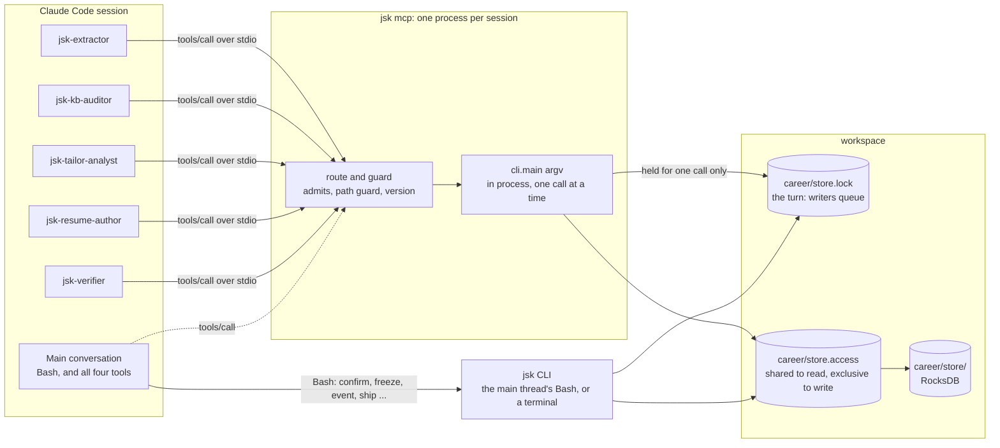

## What was measured (prototype, 2026-09-30, Windows 11, pyoxigraph 0.5.11)

A stdlib-only prototype of the server (`mcp_sketch.py`, about 170 lines) was driven over a real
pipe by a client script that speaks the protocol the way Claude Code does. It ran against a
scratch workspace made with `jsk new`, from the session scratchpad at `4768473`.

| Check | Result |
|---|---|
| `initialize` (asked `2025-06-18`) → `tools/list` → `tools/call` | Worked; `serverInfo {name: jsk, version: 4.4.0}` |
| `tools/list` for four tools, full verb lists in descriptions | 2,178 bytes (≈545 tokens by the budget tests' bytes/4) |
| `read ["--version"]`, `read ["kb","path"]` | 10 ms, 15 ms |
| `read ["kb","check"]` first call / second call | 155 ms / 45 ms (the first pays the imports) |
| `read ["kb","show","--help"]` | 1 ms, the verb's `--help` text verbatim |
| `read ["kb","confirm",…]` | Refused by the server, before jsk ran: not an MCP tool |
| `read ["kb","apply",…]`, `draft ["kb","apply",…]` without `--dry-run` | Refused: it is the `write` tool's |
| `read ["match",…,"--gaps",…]` | Refused: it is the `write` tool's |
| `draft ["kb","apply",f,"--dry-run"]`, then `write ["kb","apply",f]` | Diff and `dry run: r2 not written`, then `r2 written` |
| **CLI `jsk kb apply` in another process while the server is up** | **Landed as r3** at once. The server held no turn, no access lock and no store between calls |
| `read ["kb","log"]` after that | Saw r3: nothing was cached across calls |
| Unknown method | JSON-RPC `-32601` |
| stdin closed | Server exited 0 |
| fd 1 moved to stderr, fd 0 to `os.devnull`, protocol on dup'd handles (Windows pipes) | Worked; the protocol stream stayed clean |

A `�` in the client's console output was traced to the *client* printing to a cp1252 pipe. The
server's bytes were UTF-8 `…` (`\xe2\x80\xa6`), the same as the CLI's.

The lock behaviour the prototype measured is the one Rulings 1 and 2 rely on. The second half
of the diagram, a CLI holding the turn while the server waits, is specified under *Tests*. It
has not been run yet.

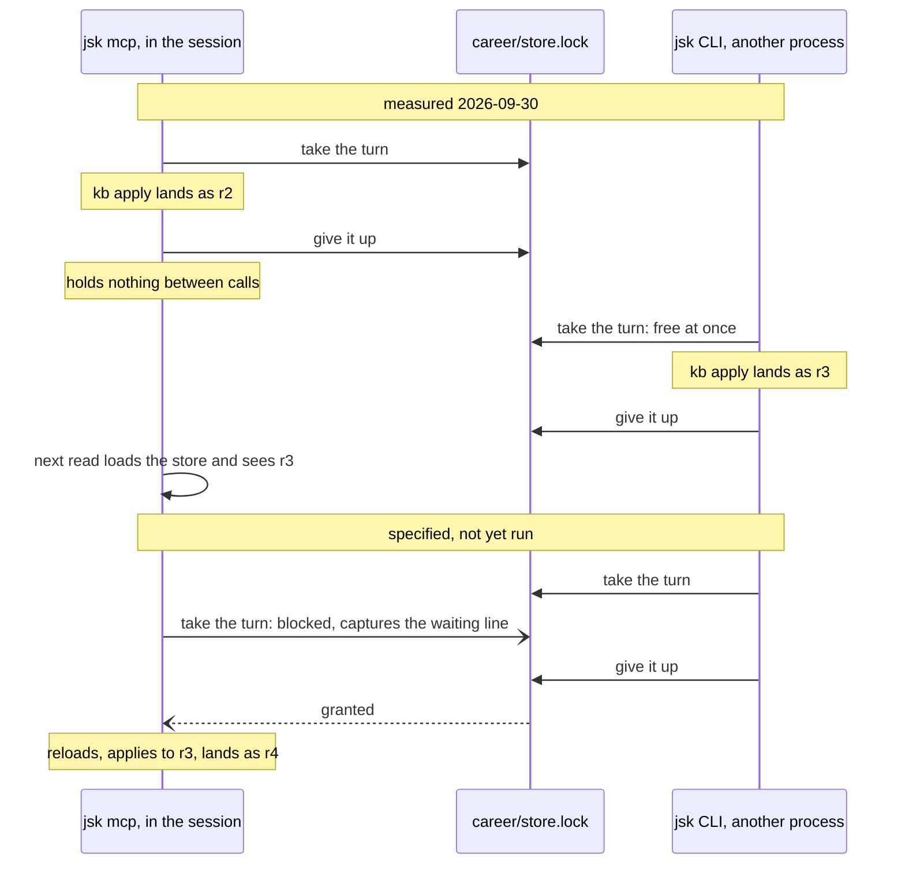

## Rulings

Each ruling says what it costs if it is wrong. Overrule any of them here, before a plan is
written.

1. **Nothing outlives a call: no store handle, no lock, no record data.** Ruling 7 of the store
   plan rejected "a long-running owner process (Oxigraph server, a session-long MCP handle)" that
   the CLI and every other session would route through. This server is not one. It is a
   long-lived *process* that holds the record for exactly as long as the CLI would. It opens and
   closes through `db.read` and `record.write_graphs` inside each call, and a second session's
   CLI never waits on it for longer than on another CLI (measured above). Every call
   re-validates, as Ruling 1 requires, so a record never answers from a copy another session has
   since changed.
   *If wrong* (loading per call is too slow): nothing in this spec prevents a cache keyed on
   the store's revision later. It is not built now because the load is within its 1.2 s budget.

2. **One call at a time, in arrival order.** Three process globals make concurrent calls
   unsafe inside one process:
   - `db._HELD` makes `write_turn` re-entrant *per process*. A second thread's write would find
     the turn "already held" and skip the lock.
   - `db._WRITING` makes a read during this process's own write raise `RuntimeError`.
   - `contextlib.redirect_stdout` and `os.chdir` are process-wide.

   So the server reads one request, runs it to the end, answers, and reads the next. Parallel
   tool calls from the model queue behind each other; the cost is at most one load per queued
   call.
   *If wrong* (queued reads are too slow): reads could run in a pool once capture and `cwd` are
   per-thread. That needs `_HELD` keyed by thread as well as by root, which is a change to
   `db.py` and belongs in its own plan.

3. **A tool call runs the CLI, `cli.main(["jsk", *argv])`, in process, and not the functions
   beneath it.** The store plan said `jsk mcp` would be "a sibling of `kbcli.py` over the same
   functions". This spec narrows that to a sibling of `cli.py`, dispatching into the same
   `kbcli.main` and the same modules, for four reasons:
   - **The prose speaks CLI.** Every refusal's `fix:` line, every `--help`, the mode files, the
     agent definitions and the token budgets are written as `jsk kb apply changes/x.trig`. A
     tool whose input is that command line needs none of them translated. Typed per-verb tools
     would need a second vocabulary kept in step with the first. That is the `okf` failure
     `WHY.md` records: the surface the skill has to name grows with the verbs.
   - **One code path.** `workspace_refusal`, `R.turn`, `write_logged`, the exit codes and every
     refusal are the CLI's own, so the suite's 1,411 tests (collected 2026-09-30) cover what the
     tools do. A
     function-level server would re-implement the dispatch (which verbs take the turn, which
     refuse an unloaded workspace) and could drift from it.
   - **Output parity.** Agents are told to relay output verbatim (`jsk validate` output
     "verbatim", `jsk-resume-author.md:123`). A tool that returns exactly what the CLI prints
     keeps that true.
   - **The functions print.** `cmd_*`, `write_logged`, `refuse`, `show_findings` and the gate
     mains all write to stdout. Calling them directly means capturing their output anyway.

   *If wrong* (structured results turn out to matter): `argv` stays as the input, and a later
   `json: true` can map to the five commands that already have `--json` (`doctor`, `match`,
   `kb query`, `gates`, `ship`). Nothing here would need undoing.

4. **Four tools, one per authority, and not one per verb.** A grant in an agent's `tools:` line
   is per tool, so the tool is the unit of authority. Each tool accepts a fixed set of verbs, and
   for six verbs a flag decides which tool it belongs to:

   | Tool | Authority | Verbs |
   |---|---|---|
   | `read` | Reads the record and applications; writes nothing | `kb path`, `kb show`, `kb view`, `kb query`, `kb log`, `kb check`; `kb export`, `kb pack`, `kb merge` *without* `--out`; `match` *without* `--gaps`/`--draft-gaps`; `posting extract`; `validate` |
   | `draft` | Writes files an agent owns, never the record | `kb apply --dry-run`; `kb export`, `kb pack`, `kb merge` *with* `--out` |
   | `write` | Writes the record: logged career changes and application graphs | `kb apply`, `posting build`, `match --gaps`/`--draft-gaps`, `tailor prepare` |
   | `gate` | Checks and fits rendered documents; reads the record | `check`, `gates`, `fit` (not `--in-place`) |

   The flag cases:
   - **`kb pack` and `kb merge` without `--out` are reads.** They print the drafted changeset and
     write nothing, so the auditor can preview a merge it recommends while holding `read` alone.
   - **`fit` without `--in-place` writes a new `<name>-fitted.tex`** beside its input
     (`fit_pages.py:360`) and leaves the rendered document as it was. `--in-place` overwrites the
     input, and `gate` refuses it. The verifier "verifies only; it never edits a document", and
     with this rule the grant keeps that true. *Overrule* to admit `--in-place`: one entry in
     `admits`.

   `--help` is admitted on every tool for any served verb, and `--version` on every tool. The
   served set is **exactly the union of what the five agents run today** (*Tool call flows*),
   and nothing beyond it. No agent runs `ship`: the verifier is called after a ship has failed,
   and the main conversation ships. So `ship` is not served, and the fourth tool is `gate`
   rather than `ship`. A verb is added later with one line in `mcp.TOOLS` and the test that names
   it.
   *If wrong* (four is too coarse): the resume author holds `write` for `kb apply`, and so could
   also run `posting build --replace` or `tailor prepare`. That is the residual, and it is stated
   rather than hidden. Splitting `write` into `write_career` and `write_application` is one entry
   in the table and costs about 60 resident tokens.

5. **Not served at all: `kb confirm`, `freeze`, `event`, `new`, `kb load`, `kb dump`.** The first
   three record the person's own words or acts: an answer, a submission, a reply. `WHY.md` already
   calls `confirm --answer` "an instruction with an audit trail". Keeping it off every tool means
   no agent can be granted it by mistake. The last three create, fill or copy out a whole
   workspace. The main conversation keeps running all six through `Bash` as it does today. The
   refusal names the CLI form: ``jsk kb confirm is not an MCP tool: it records the person's
   words, so the conversation runs it as `jsk kb confirm …` ``.
   `posting fetch`, `ship`, `render`, `preview` and `doctor` are not refused as acts
   of the person. They are simply not served, because no agent runs them, and the main
   conversation runs them through `Bash`. The refusal for these says so: ``jsk ship is not
   served to agents: the conversation runs it``.
   *If wrong* (the main thread should go shell-free too): add a fifth tool, `person`, and grant
   it to no agent. The routing already refuses these verbs by name.

6. **Agents lose `Bash`.** Every agent's `jsk` use maps onto the four tools (see *Agents*), and
   none uses the shell for anything else. `grep` of the five definitions finds only the `jsk`
   fallback lines. So `Bash` leaves every `tools:` line, and the prose rules that stood in for a
   grant ("never applies", "never changes the career") stay as explanation. They are no longer
   the enforcement. The main conversation keeps `Bash`.
   *If wrong* (an agent needs a shell for something unforeseen): give that agent `Bash` back.
   The grant table shows the loss.

7. **No new runtime dependency: the server speaks the protocol with the standard library.**
   `pyproject.toml` says of pyoxigraph "One dependency, and only one". The `mcp` SDK brings
   pydantic, pydantic-settings, anyio, httpx, httpx-sse, starlette, sse-starlette, uvicorn,
   jsonschema and python-multipart, for a server that uses one transport (stdio) and one feature
   (tools). The subset needed is five methods (*Protocol*), and the prototype does it in about 170
   lines. The official SDK joins the **dev** extra only, as the client in a conformance test.
   *If wrong* (the protocol moves faster than the subset can follow): the tool table, routing,
   isolation and tests carry over unchanged, and only `mcp.py`'s framing would be replaced by
   `FastMCP`. Version negotiation (*Protocol*) means an unknown client version degrades to the
   newest one the server knows. It does not break.

8. **The protocol owns file descriptors 0 and 1; nothing else can reach them.** At start-up the
   server dups fd 0 and fd 1 into private handles for the protocol. It then points fd 1 at fd 2
   and fd 0 at `os.devnull`, and sets `sys.stdout = sys.stderr`. After that:
   - A stray `print`, a child process that inherits fd 1, or a C extension writing to it lands on
     stderr. Claude Code logs stderr and does not parse it.
   - A read of stdin gets end-of-file, never the next JSON-RPC message.

   Today both subprocess calls in `src/jsk` capture their output (`render/tex.py:74`,
   `preflight.py:337`), so this is a defence against the next one, not a fix for a known leak.
   Inside a call, `sys.stdout`, `sys.stderr` and `sys.stdin` are rebound for the call's
   duration (*The call*).
   *If wrong* (dup2 misbehaves on a platform): it was checked on Windows pipes. The Linux CI job
   runs the same test first.

9. **A call's output is the CLI's output, once.** stdout and stderr are captured into one
   buffer, in the order written, as a terminal would show them. The result is one `text` content
   block:
   - It is returned unchanged when it fits.
   - Otherwise it keeps the first 60,000 and the last 20,000 characters, with a line between
     them: `… N characters left out - narrow the command (--section, --last, --out FILE)`. The
     head is kept because `kb view` is read top-down; the tail because a diff ends in
     `rN written`.
   - When the exit code is not 0, the text ends `[exit N]` and `isError` is `true`. A refusal
     (exit 1) is the most important thing an agent can be told, so it is never left looking like
     success.

   No `structuredContent` and no `outputSchema` in this version.
   *If wrong* (80,000 characters exceeds what Claude Code accepts): P0 measures the limit, and
   the cap becomes a constant set from it.

10. **`cwd` is an argument, and nothing reaches `career/` or `.jsk/` through a path.** Each call
    takes an optional absolute `cwd`, defaulting to the directory the server started in. Relative
    paths in `argv` resolve against it, as they would in a shell. The server refuses any `argv`
    item that resolves *strictly inside* the workspace's `career/` or `.jsk/` directories, which
    hold the store, its two lock files and the backup. An item equal to `career` itself (a
    section name, say) is allowed. The check looks for the workspace from `cwd` the way
    `kbcli.find_root` does. Agents are already forbidden to read `career/` (tested,
    `test_plugin_surface.py:300`). The new danger is a *write*: `kb export --out
    career/store/CURRENT` or `kb pack --out career/store.lock` would overwrite a RocksDB file.
    *If wrong* (a legitimate argument points inside `career/`): no served verb takes one today,
    and the refusal names the item.

11. **The plugin starts the server with `jsk mcp`, and setup proves it answers.**
    `plugins/jsk/.mcp.json` declares `{"jsk": {"command": "jsk", "args": ["mcp"]}}`, and
    Claude Code names the tools `mcp__plugin_jsk_jsk__read` and so on. `jsk mcp --check`
    starts the server on a pipe, runs `initialize` and `tools/list`, calls `read ["--version"]`,
    and prints one line or a refusal with a fix. `mode-setup.md` runs it after `jsk doctor`.
    When the tools are missing from a session (not installed, not on PATH, the server failed to
    start), the skill dispatches no agent. It runs setup's fix instead, because an agent without
    `Bash` and without the tools can do nothing.
    *If wrong* (`jsk` is often off PATH where `python -m jsk` works): P0 checks whether Claude
    Code expands `${VAR:-default}` in `.mcp.json`. If it does, `command` becomes
    `${JSK_COMMAND:-jsk}` and setup writes the variable. If not, setup reports the exact
    interpreter to add to PATH.

12. **A server older than the installed jsk refuses, rather than answering as the old code.**
    Before each call the server compares `importlib.metadata.version("jsk")` with the
    `jsk.__version__` it loaded, and pyoxigraph's version the same way. On a mismatch every tool
    answers `jsk was upgraded to X while this session's server runs Y`, with the fix `/mcp →
    reconnect jsk, or restart the session`. The store format is tied to the pyoxigraph version
    (store plan, *Risks*), so a server on the old one must not write.
    *If wrong* (the check costs too much per call): it is two metadata reads, measured in P1.

13. **A command's crash is answered; a leaked lock ends the server.** Any exception out of
    `cli.main` becomes exit 2, with the last 4,000 characters of the traceback in the text. The
    traceback's frames are then cleared (`traceback.clear_frames`), the exception is dropped, and
    `gc.collect()` runs. pyoxigraph has no `close()`: a store closes when its last reference goes
    (store plan, amendment 3). So a frame kept alive by a stored traceback would keep a read-only
    handle open, and on Windows that fails another process's write ("Access is denied" on
    CURRENT). After every call the server asserts `db.idle()` (new: no turn held, no store open
    for writing, in this process). If that fails, the server writes a line to stderr and exits 3.
    A server that might be holding the turn must not stay up holding it. Claude Code shows the
    server as disconnected, and the next session starts a fresh one.
    *If wrong* (exiting is too abrupt): there is no safe alternative. A held turn blocks every
    jsk write on the machine for that workspace.

## Protocol

Newline-delimited JSON-RPC 2.0 over stdio, UTF-8. One message per line, and no embedded
newlines (`json.dumps` guarantees that). Logs go to stderr only.

What Ruling 8 does to the file descriptors at start-up, so that only the protocol can reach
Claude Code's pipes:

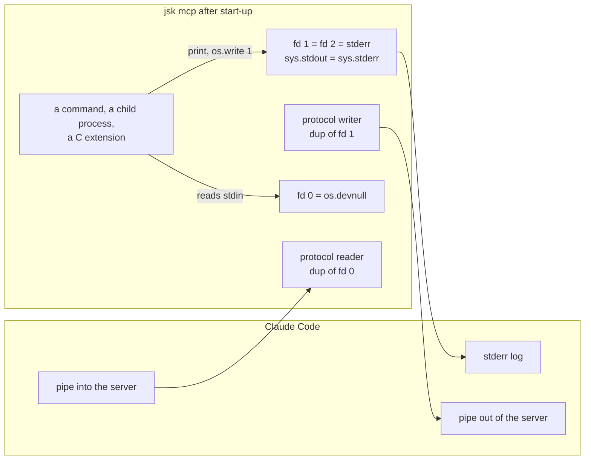

| Message | Server behaviour |
|---|---|
| `initialize` | Reply `protocolVersion` = the client's if it is in `PROTOCOLS`, else the newest in `PROTOCOLS`; `capabilities: {tools: {listChanged: false}}`; `serverInfo: {name: "jsk", version}`. No `instructions` (they would be resident in every session; the skill already says when to use the tools) |
| `notifications/initialized` | Nothing |
| `ping` | `{}` |
| `tools/list` | The four tools (*Tool definitions*). No pagination: `nextCursor` omitted |
| `tools/call` | *The call*. Tool-level failures, including refusals and routing, are a **result** with `isError: true`, never a JSON-RPC error |
| `notifications/cancelled` | A queued request with that id is dropped without a reply. A running one runs to the end, because a write is never interrupted halfway through its turn, and its reply is suppressed |
| any other request | Error `-32601` |
| a line that is not JSON | Error `-32700`, `id: null` |
| `tools/call` with an unknown tool, or `argv` not a non-empty list of strings, or `cwd` not an absolute existing directory | Error `-32602` |
| an array (a JSON-RPC batch) | Each element handled in order and the replies sent as an array. Harmless to support, and older protocol versions allowed it |
| end of stdin | Exit 0 |

`PROTOCOLS = ("2025-06-18", "2025-03-26", "2024-11-05")`. The tools subset used here is the
same in all three. P0 records the version the current Claude Code sends. If that version is
newer and changes nothing this server uses, it joins the tuple, with the conformance test run
against it.

## Tool definitions

All four tools share one input schema:

```json
{
  "type": "object",
  "additionalProperties": false,
  "required": ["argv"],
  "properties": {
    "argv": {"type": "array", "items": {"type": "string"}, "minItems": 1,
             "description": "The jsk command line without `jsk`, one argument per item: [\"kb\", \"show\", \"k:prj_x\"]"},
    "cwd":  {"type": "string",
             "description": "Absolute directory to run in; relative paths in argv resolve here. Default: the session's."}
  }
}
```

| Name | `title` | `description` (resident: keep to one sentence plus the verb list) | Annotations |
|---|---|---|---|
| `read` | Read the career | "Run a jsk command that reads: kb path/show/view/query/log/check, kb export/pack/merge (no --out), match (no --gaps), posting extract, validate." | `readOnlyHint: true`, `idempotentHint: true`, `openWorldHint: false` |
| `draft` | Draft a change | "Run a jsk command that writes a draft file, never the record: kb apply --dry-run, kb export/pack/merge --out." | `readOnlyHint: false`, `destructiveHint: false`, `openWorldHint: false` |
| `write` | Change the record | "Run a jsk command that writes the record: kb apply, posting build, match --gaps/--draft-gaps, tailor prepare." | `readOnlyHint: false`, `destructiveHint: true`, `idempotentHint: false`, `openWorldHint: false` |
| `gate` | Check a render | "Run a jsk gate on rendered files: check, gates, fit (never --in-place)." | `readOnlyHint: false`, `destructiveHint: false`, `openWorldHint: false` |

`write` is marked destructive because `kb apply` can `op:delete` and `op:retire`, and
`posting build --replace` drops the gaps graph. Everything it does is logged and versioned, but
the hint is about what a call does, not whether it can be undone later.

**Routing** (`mcp.admits(tool, argv) -> None | refusal`):

- The verb key is `argv[0]`. For the grouped commands (`kb`, `posting`, `tailor`) it is `argv[0]
  argv[1]`, when `argv[1]` is not a flag.
- `--help` anywhere after the verb, or `argv == ["--version"]`, is admitted on any tool.
- A verb in `NOT_SERVED` gets Ruling 5's refusal.
- A verb the CLI has that no tool serves (`ship`, `render`, `preview`, `posting fetch`,
  `doctor`) gets ``jsk X is not served to agents: the conversation runs it``.
- A verb the CLI does not have: `unknown command: X` with `fix: jsk --help`, as the CLI says.
- For a verb the tool does not hold, the refusal names the tool that does and, where a flag
  moves it, the flag. The draft tool without `--dry-run` answers ``kb apply without --dry-run
  writes the record: it is the write tool's. fix: add --dry-run to try it here``. The gate tool
  answers `fit … --in-place` with ``fit --in-place overwrites the rendered document. fix: drop
  --in-place; fit writes <name>-fitted.tex beside it``.
- Flag routing looks only for the presence of `--dry-run`, `--out`, `--gaps`, `--draft-gaps` or
  `--in-place` in `argv`. The CLI's own `parse_flags` still validates the rest, so `--out=x`
  spelling and repeats are refused there exactly as on the command line.

Every check before `cli.main` runs, in order. Each refusal is a result with `isError: true` and
never reaches jsk:

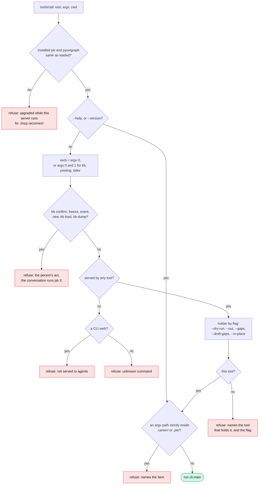

## The call

```python
def run(argv, cwd):
    """cli.main(argv) with stdout and stderr captured together and stdin empty."""
    buf = io.StringIO()
    here = os.getcwd()
    code = 2
    try:
        os.chdir(cwd)
        with contextlib.redirect_stdout(buf), contextlib.redirect_stderr(buf):
            old_in, sys.stdin = sys.stdin, io.StringIO("")
            try:
                code = cli.main(["jsk", *argv])
            finally:
                sys.stdin = old_in
    except SystemExit as e:
        code = e.code if isinstance(e.code, int) else (0 if e.code is None else 2)
    except Exception as e:  # noqa: BLE001 - the server outlives a command's bug
        tb = e.__traceback__
        buf.write("".join(traceback.format_exception(type(e), e, tb))[-4000:])
        traceback.clear_frames(tb)
        del e, tb
    finally:
        os.chdir(here)
        gc.collect()        # a store a dead frame held is closed now, not whenever
    return code, buf.getvalue()
```

This is the prototype's core as it ran. `cliutil.utf8_stdout()` already leaves a `StringIO` as it
is. `SystemExit` covers `argparse` in `fit_pages.py`, which exits 2 on a bad flag. A
`KeyboardInterrupt` is not caught: it stops the server, as Ctrl-C should.

The order around a call:

1. Check the version (Ruling 12).
2. Route (Ruling 4).
3. Guard paths (Ruling 10).
4. `run`.
5. Assert `db.idle()` (Ruling 13).
6. Cap the text (Ruling 9).
7. Reply.

Here is one `write` call from start to finish. The locks are the CLI's own, taken inside
`cli.main` exactly as on the command line:

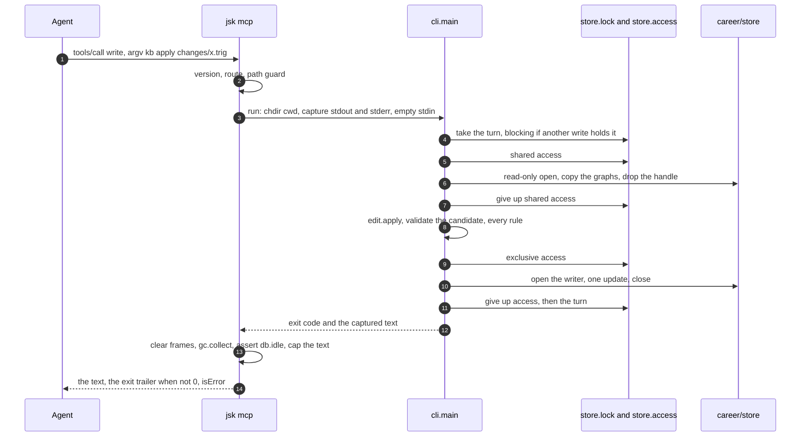

A write that has to wait for another session's turn prints `waiting for another jsk write to
finish (…)` to stderr, as it does today. The server captures it and returns it in the text once
the call ends. No progress notification is sent in this version.

## Architecture

```
src/jsk/mcp.py            NEW  serve(): fd isolation, the read-answer loop, the five methods;
                               TOOLS, NOT_SERVED, admits(), guard_paths(), run(), capped();
                               check(): the --check self-test. Imports cli lazily, per call's
                               first use, like every other command (PLC0415 is deliberate)
src/jsk/cli.py                 `mcp` joins HANDLERS (-> mcp.main); NO_RECORD gains it, since
                               the server starts without a workspace and each call finds its own
src/jsk/graph/db.py            idle() -> bool: not _HELD and not _WRITING. Public, so mcp.py
                               never touches db's privates
plugins/jsk/.mcp.json     NEW  {"jsk": {"command": "jsk", "args": ["mcp"]}}
plugins/jsk/agents/*.md        tools: lines (below); the "jsk not found -> python -m jsk" lines
                               go; "run `jsk kb show`" becomes "call read with [kb, show, …]"
                               only where the call's shape is not obvious from the CLI form
plugins/jsk/skills/jsk/        SKILL.md: `jsk mcp` in the command table (tested: every
                               subcommand is named there); mode-setup.md: `jsk mcp --check`
```

`mcp.py` is a sibling of the other command modules. It never imports `pyoxigraph`, never opens a
store, and never mentions `replace_graphs`, so `OnlyDbKnowsTheStore` (`tests/test_db.py:417`)
passes unchanged. A new case in that test pins the rule: `mcp.py` reaches jsk only through
`cli.main` and `db.idle`. Beyond Ruling 13's `idle()` there is no new seam in the graph package.

### Agents

What each agent runs today, read from its definition on 2026-09-30, and its grant after this
spec. **read** is `mcp__plugin_jsk_jsk__read`, and so on for the other tools.

| Agent | `jsk` commands in its definition | `tools:` before | `tools:` after |
|---|---|---|---|
| `jsk-extractor` | kb path, kb query similar, kb view --section, kb show, kb apply --dry-run | Read, Write, Glob, Grep, Bash | Read, Write, Glob, Grep, **read, draft** |
| `jsk-kb-auditor` | kb path, kb check, kb query (unconfirmed, open, stale, pipeline, duplicates, bare), kb view, kb log, kb show, validate; kb merge to preview | Read, Write, Glob, Grep, Bash | Read, Write, Glob, Grep, **read** |
| `jsk-tailor-analyst` | kb path, posting extract, kb query concepts --near, posting build [--replace], tailor prepare --draft-gaps, kb show --bullets, kb query evidence, match --gaps | Read, Write, Edit, Glob, Grep, Bash | Read, Write, Edit, Glob, Grep, **read, write** |
| `jsk-resume-author` | kb path, kb export --from-match --out [--select] [--replace], kb show --bullets, kb view --section, kb apply --dry-run, kb apply, match --gaps, validate | Read, Write, Edit, Glob, Grep, Bash | Read, Write, Edit, Glob, Grep, **read, draft, write** |
| `jsk-verifier` | validate, gates, check (parse, prose, layout), fit, kb show | Bash, Read, Glob | Read, Glob, **read, gate** |

Every definition loses its binary-finding line ("run `jsk`; not found, fall back to `python -m
jsk`, then `py -3 -m jsk`"), and the verifier loses "Report which you used".

Here is the same grant as a map. An arrow is a tool on the agent's `tools:` line. A verb in no
tool box cannot be reached by any agent:

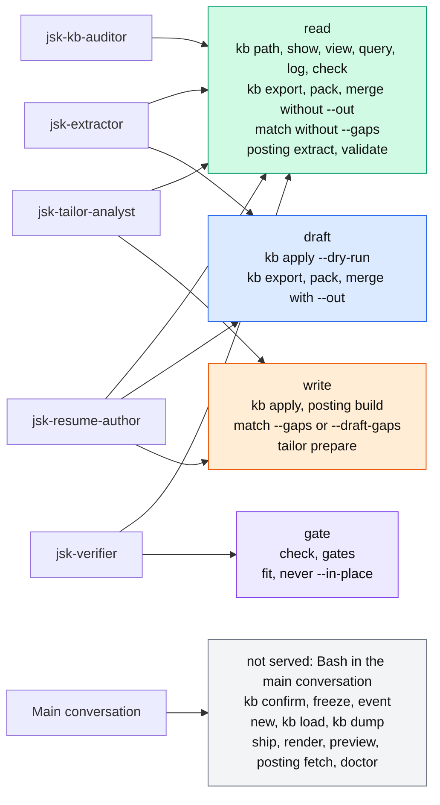

### Tool call flows

The calls each agent makes, in order, as its definition prescribes them. Each agent has a
diagram showing the flow's shape and a block showing the exact arguments. The blocks are the
fixture for *Tests*' "the grant covers the procedure". Each call is written `tool [argv]`, the
arguments that follow `jsk`, and `cwd` is the workspace unless a flow says otherwise. Calls to
the file tools (Read, Write, Edit, Glob) are shown where they sit between jsk calls, because the
loops run through them.

The diagrams colour each step by the tool it uses:

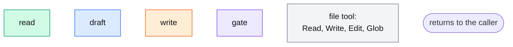

**`jsk-extractor`** (`read`, `draft`)

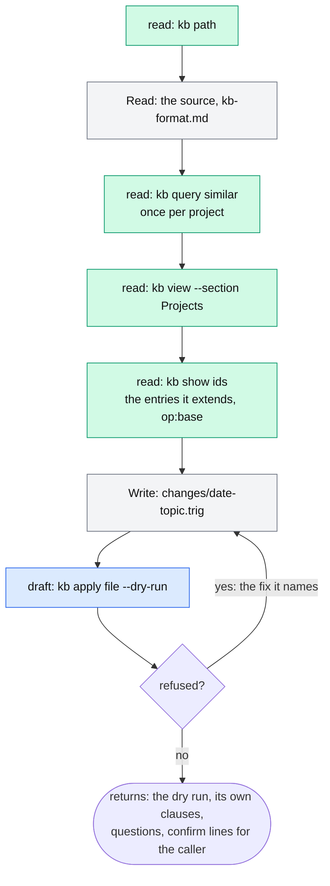

```
read   [kb, path]                                   the workspace, before anything else
Read   the source file(s), references/kb-format.md
read   [kb, query, similar, "<the project's words>"]   once per project the source describes
read   [kb, view, --section, Projects]
read   [kb, show, <ids>]                            the entries it extends, and the op:base
Write  changes/<date>-<topic>.trig
draft  [kb, apply, changes/<date>-<topic>.trig, --dry-run]
       refused → Write the fixed file → the dry run again, until it passes
```

It returns the dry run, the clauses that are not the source's words, and, for an imported
document, the `kb confirm … --source … --quote …` lines it believes the document supports. The
caller runs those through `Bash` with the person present. Refused if tried: `write [kb, apply,
…]` (the tool is not on its line), and `[kb, confirm, …]` on any tool (not served).

**`jsk-kb-auditor`** (`read`)

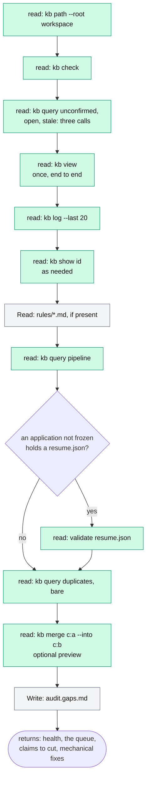

```
read   [kb, path, --root, <workspace>]
read   [kb, check]
read   [kb, query, unconfirmed]
read   [kb, query, open]
read   [kb, query, stale]
read   [kb, view]                                   once, end to end
read   [kb, log, --last, 20]
read   [kb, show, <id>]                             where it needs an entry exactly as held
Read   rules/*.md beside career/, if present
read   [kb, query, pipeline]
read   [validate, applications/<stem>/resume.json]  each application not frozen that holds one
read   [kb, query, duplicates]
read   [kb, query, bare]
read   [kb, merge, c:a, --into, c:b]                optional: preview a merge it recommends
Write  <workspace>/audit.gaps.md
```

`kb view` is the one call in any flow that a large career could push past Ruling 9's cap. The
cap's line tells the auditor to narrow the call with `--section`, one section at a time. It has
no way to change the record, even through a draft file.

**`jsk-tailor-analyst`** (`read`, `write`)

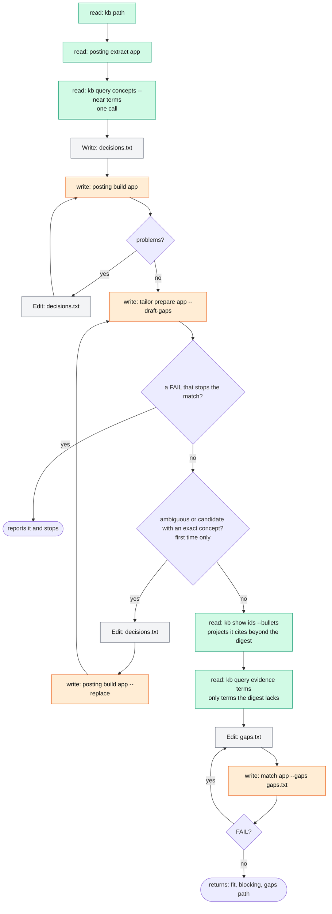

```
read   [kb, path]
read   [posting, extract, applications/<stem>]
read   [kb, query, concepts, --near, "<term>", "<term>", …]   one call, the unproposed terms
Write  applications/<stem>/decisions.txt
write  [posting, build, applications/<stem>]        every problem at once → Edit → again
write  [tailor, prepare, applications/<stem>, --draft-gaps]
       a FAIL that stops the match → report it and stop
       an ambiguous or candidate term with an exact concept (at most once):
         Edit decisions.txt → write [posting, build, applications/<stem>, --replace]
                            → write [tailor, prepare, applications/<stem>, --draft-gaps]
read   [kb, show, <ids>, --bullets]                 each project it cites beyond the digest
read   [kb, query, evidence, <the posting's terms>] only for a term the digest lacks
Edit   applications/<stem>/gaps.txt
write  [match, applications/<stem>, --gaps, applications/<stem>/gaps.txt]
       a FAIL → Edit gaps.txt → again, until it writes
```

It returns three lines (`fit:`, `blocking:`, `gaps:`). It holds `write`, but its definition
never runs `kb apply`. The grant does not stop it, and the residual is listed below.

**`jsk-resume-author`** (`read`, `draft`, `write`)

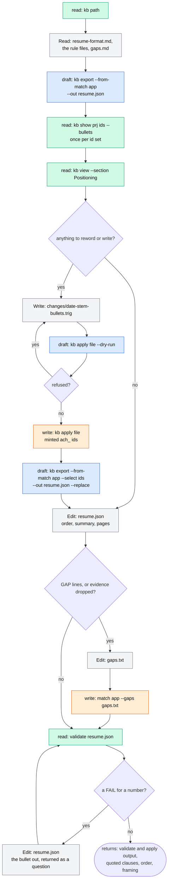

```
read   [kb, path]
Read   references/resume-format.md, the rule files the prompt names, gaps.md
draft  [kb, export, --from-match, applications/<stem>, --out, applications/<stem>/resume.json]
read   [kb, show, <prj ids>, --bullets]             once per id set; only projects it rewords
read   [kb, view, --section, Positioning]
Write  changes/<date>-<stem>-bullets.trig
draft  [kb, apply, changes/<date>-<stem>-bullets.trig, --dry-run]
write  [kb, apply, changes/<date>-<stem>-bullets.trig]   prints the minted ach_ ids
draft  [kb, export, --from-match, applications/<stem>, --select, <ach ids>,
        --out, applications/<stem>/resume.json, --replace]
Edit   applications/<stem>/resume.json              bullets order, summary, pages
Edit   applications/<stem>/gaps.txt                 short: lines for GAPs and dropped evidence
write  [match, applications/<stem>, --gaps, applications/<stem>/gaps.txt]   only after that edit
read   [validate, applications/<stem>/resume.json]  once; again only if the file changed
```

When nothing was reworded, the calls from the changeset `Write` through the second export are
skipped. Its definition's "do not re-run `jsk match`" means the read-only match. The
`--gaps` match that rewrites `gaps.md` after it edits `gaps.txt` is a separate call, and it is
in the grant.

**`jsk-verifier`** (`read`, `gate`)

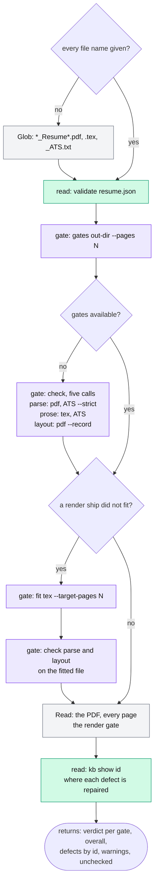

```
Glob   *_Resume*.pdf, *_Resume*.tex, *_Resume_ATS.txt   only when a file name is missing
read   [validate, <out>/resume.json]
gate   [gates, <out-dir>, --pages, N]
       unavailable → the four gates one by one:
         gate [check, <Name>_Resume.pdf, --only, parse]
         gate [check, <Name>_Resume_ATS.txt, --only, parse, --strict]
         gate [check, <Name>_Resume.tex, --only, prose]
         gate [check, <Name>_Resume_ATS.txt, --only, prose]
         gate [check, <Name>_Resume.pdf, --only, layout, --record, <out>/resume.json]
gate   [fit, <Name>_Resume.tex, --target-pages, N]  only for a render ship did not fit
       → the parse and layout checks again, on the fitted file
Read   the PDF, every page                          the render gate
read   [kb, show, <id>]                             to name where each defect is repaired
```

### What the grants change, and what they do not

The grants enforce what the definitions could only ask:

- The extractor and the auditor cannot write the record, and the auditor cannot write even a
  draft through jsk.
- No agent can confirm, freeze or record an event, on any tool.
- The verifier cannot change the record or overwrite a rendered document. It has no Write or
  Edit, and the only file it can create is `fit`'s `<name>-fitted.tex`.

What they leave open:

- **`write` is coarser than the procedures.** The analyst holds `kb apply` and never runs it.
  The author holds `posting build` and `tailor prepare` and never runs them. Ruling 4's *If
  wrong* prices the split.
- **Write and Edit are not covered by Ruling 10's guard.** That guard checks only the paths in
  jsk's `argv`. Four agents hold `Write`, and `Write` can overwrite a file under
  `career/store/`, as it can today. No MCP grant can close that. A `PreToolUse` hook in the
  plugin that denies `Write`/`Edit` under any `career/` or `.jsk/` directory would close it. It
  is out of this spec's scope and is named under *Risks* so it is not lost.

## Budgets

`tests/test_budget.py` gains `ToolListCost`. The four definitions, serialised as `tools/list`
returns them, are counted with the file's bytes/4. The ceiling is set from the P1 measurement
plus headroom, with the measured number in its comment. The prototype's 2,178 bytes (≈545
tokens) is the starting point. Whether the list is resident in each agent's context or deferred
behind tool search is a Claude Code behaviour that P0 records, and the comment says which.

The agent definitions each lose their binary fallback line (about 40 tokens each) and gain
nothing, so their ceilings move down, each deliberately. `SKILL.md` gains one table row for
`jsk mcp` against its 2,400 ceiling (2,238 measured on 2026-09-29).

## Phases

Each phase ends green (`uv run pytest`, ruff, pyright) and is committed on its own.

### P0: facts about Claude Code, measured before the plan relies on them

Run against the Claude Code version then current, and write the answers into the plan:

1. A plugin's `.mcp.json` at `plugins/jsk/` is loaded, and the tools are named
   `mcp__plugin_jsk_jsk__<tool>`, as Playwright's are in this session.
2. A subagent whose `tools:` line names those tools, and not `Bash`, can call them; a subagent
   that does not name them cannot.
3. Whether plugin MCP tools are resident in a subagent's context or deferred behind tool
   search (it sets what `ToolListCost` guards).
4. The directory the server starts in (it sets `cwd`'s default).
5. Whether `${VAR:-default}` expands in a plugin's `.mcp.json` (Ruling 11).
6. The tool-result size limit and the per-call timeout, and their environment overrides (Ruling
   9's cap; a `fit`, which compiles LaTeX once per attempt, must fit the timeout).
7. The `protocolVersion` Claude Code sends, and whether it sends a second `tools/call` before
   the first is answered (it tells us whether Ruling 2's queue is ever exercised).
8. How an `isError: true` result reads to the model, and whether a first use of each tool
   prompts for permission in default and auto modes (setup may need an allowlist line for the
   `read` tool).

### P1: the server

- `mcp.py` as specified, plus `db.idle()` and `cli.py`'s registration.
- `tests/test_mcp.py`. The protocol is driven over a real pipe to `python -m jsk mcp`,
  and the rest through `mcp.handle` in process. Every case under *Tests*.
- `ToolListCost` with its measured ceiling.

### P2: the plugin

- `.mcp.json`; `jsk mcp --check`; `mode-setup.md`'s step and its refusal when the tools are
  missing.
- The five agents' `tools:` lines and prose, as the *Agents* table and *Tool call flows* give
  them.
- The skill's rule for dispatching: no tools in this session → no agent, run setup's fix.
- Plugin, marketplace and package version to 4.5.0 together (`Manifests` test).

### P3: prose and documents

- `docs/ARCHITECTURE.md`: `mcp.py`, and the dispatcher's subcommand count (tested).
- `docs/SCRIPTS.md`: `jsk mcp` and `--check` (tested).
- `docs/WHY.md`: one row added to the `okf` table ("an agent told never to write held a shell
  that could" → "the grant is the rule: agents hold the tools their authority needs, and no
  shell"), and a paragraph on why the tool input is the command line (Ruling 3).
- `README.md` and `QUICKSTART.md`: nothing to install beyond jsk. Setup checks the server.

### P4: review and replay

- One opus review of the code, one of the prose; a fix pass.
- The replay on a **scratch copy** of the real workspace (never the real folder): a tailoring
  run end to end with the agents on the tools, compared with the Arrow/Schneider baseline
  (`experiments/2026-09-29-tailor-time/`) for turns, and for any agent that tried to reach for a
  command it was not granted.

## Tests

**Protocol**
- `initialize` with a known version echoes it. With an unknown one it answers
  `PROTOCOLS[0]`.
- `tools/list` has exactly four tools, and each input schema is the one above.
- `ping`; `-32601` for an unknown method; `-32700` for a bad line; `-32602` for each malformed
  `tools/call`; a notification gets no reply; a batch gets an array; end of stdin exits 0.
- `notifications/cancelled` for a queued id suppresses its reply.

**Routing**
- Every verb in `TOOLS` is admitted by its tool(s) and refused by the others, and each refusal
  names the right tool.
- `NOT_SERVED` verbs are refused on all four tools with Ruling 5's text. `ship`, `render`,
  `preview`, `posting fetch` and `doctor` are refused with "not served to agents".
- The flag cases:
  - `kb apply` with and without `--dry-run`;
  - `kb export`, `kb pack` and `kb merge` each with and without `--out`;
  - `match` with `--gaps` and with `--draft-gaps`;
  - `fit` with and without `--in-place`.
- `--help` and `--version` are admitted everywhere.
- **The grant covers the procedure** (in `test_plugin_surface.py`). Every `jsk <verb>` an agent
  definition tells it to run, flags included, is admitted by a tool on that agent's `tools:`
  line. No agent's line holds `Bash`. Each agent's MCP tools are exactly the *Agents* table's:
  the auditor holds `read` alone, and the verifier holds no Write or Edit. The *Tool call flows*
  are the test's fixture. A definition that gains a command its grant does not cover fails here,
  before any session finds out.

**Isolation**
- A command that `os.write(1, …)`s lands on stderr, and the next reply parses.
- A command that reads `sys.stdin` gets `""`.
- A subprocess started with inherited stdio cannot write into the protocol.

**State across calls** (the reasons for Rulings 1, 2 and 13)
- A server `write` landing, then a CLI `kb apply` in another process landing next, then a server
  `read` seeing both (the prototype's check, kept).
- A CLI process holding the turn: a server `write` waits, lands after it, and its text includes
  the waiting line.
- An exception forced inside `db.read`'s copy (monkeypatched): after the reply, a subprocess
  `jsk kb apply` succeeds. Run on Windows, this is the test that fails without
  `clear_frames` + `gc.collect()`.
- An exception forced inside `db.writing`: `db.idle()` holds after the reply, and the next CLI
  write lands.
- `_HELD` left non-empty by a planted fault: the server exits 3 and says why on stderr.
- A parity sweep: for each read command in the fixtures, the server's text equals the CLI
  subprocess's stdout+stderr, exit code included.

**Guards**
- Path guard: `--out career/store/x`, `--out ./career/store.lock`, `--out ../ws/.jsk/backup.trig`
  and a symlink into `career/` are all refused; `--section career` is admitted.
- Version skew: patch the installed version and every tool refuses with the reconnect fix.
- The cap: a 200,000-character output comes back as head, the narrowing line, and tail.

**Conformance** (skipped when the dev extra is absent): the official `mcp` SDK's stdio client
runs `initialize`, `tools/list` and one `tools/call` of each tool against `python -m jsk mcp`.

**Layering**: `OnlyDbKnowsTheStore` gains the `mcp.py` case (Ruling 13's last sentence).

## Risks

- **Claude Code's behaviour is the unverified half.** Everything P0 lists was inferred from
  this session (the Playwright tool names) and not tested against a plugin of ours. P0 comes first
  for that reason. If P0's second check fails (subagents cannot be limited to MCP tools), this
  spec's goal fails with it, and the plan stops there rather than shipping a server that only
  saves 150 ms.
- **Write and Edit can still reach `career/`.** The grants cover jsk and nothing else, and four
  agents keep `Write`. A plugin `PreToolUse` hook that denies `Write`/`Edit` to any path under a
  `career/` or `.jsk/` directory would close the gap. It is not in this spec's phases. The
  follow-up is recorded here so the grant table is not mistaken for the whole guard.
- **The Linux branch is untested.** dup2 isolation and the `flock` turn were exercised on
  Windows only. The store plan's Linux CI job, still open (store plan, *Status*), runs
  `test_mcp.py` too.
- **A hung call blocks the session's tools.** Calls are serial (Ruling 2), so a `fit` stuck in
  LaTeX holds up every later call until `render/tex.py`'s `TIMEOUT`. That is the same as a hung
  Bash call today, and it is bounded by the same timeout.
- **Two sessions, two servers.** Each Claude Code session starts its own server. They share
  nothing but the store's locks, which is exactly how two CLIs behave. There is nothing new to
  coordinate, and the queue test above covers it.
- **Stale code after an upgrade.** This is covered by Ruling 12. The cost is that a person who
  upgrades mid-session sees tools refuse until they reconnect. That is intended.
- **Prose drift between "run `jsk X`" and "call read with [X]".** The procedure test above
  parses agent prose for `jsk <verb>`, so the CLI form stays the one written everywhere. The
  tool's input *is* that form (Ruling 3), so there is no second vocabulary to drift.

## Verification (after P2, again after P4)

1. `uv run pytest`, ruff and pyright clean; the Windows and Linux CI jobs green.
2. In a real Claude Code session with the plugin installed from this branch, run
   `/jsk:tailor` on a saved posting. The analyst and author run with no `Bash`, the transcript
   shows only `mcp__plugin_jsk_jsk__*` calls for jsk, and the resume ships.
3. In the same session, ask the extractor to "apply it". It has no tool that can, and says so.
4. With the session open, `jsk kb apply` from a terminal lands. A `read` in the session sees the
   new revision on its next call.
5. `pip install` a new jsk version with the session open. The next tool call refuses with the
   reconnect fix, and after `/mcp` reconnect it answers.
